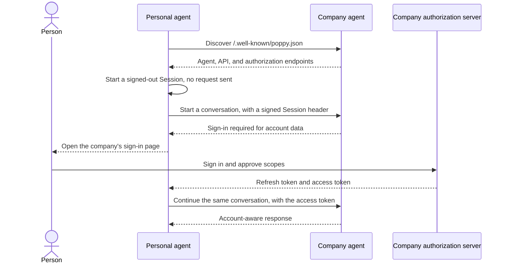

<!--
  ~ Copyright (c) 2025-2026 Datalayer, Inc.
  ~
  ~ BSD 3-Clause License
-->

[](https://datalayer.ai)

# 🤖 🌸 Personal Agent Protocol

Python and TypeScript SDKs for the
[Personal Agent Protocol](https://personalagentprotocol.org): both implement
[draft 0.3](https://personalagentprotocol.org/docs/0.3/spec) (2026-10-28) and its
Operations extension v2. See
[Compatibility](https://personal-agent-protocol.datalayer.tech/releases/compatibility/),
[Migration](https://personal-agent-protocol.datalayer.tech/releases/migration/),
the [conformance report](https://personal-agent-protocol.datalayer.tech/protocol/conformance-report/),
and [Support](https://personal-agent-protocol.datalayer.tech/releases/support/).


PAP lets a personal agent discover and talk to a company's agent on behalf of
a person. The company remains responsible for its identity, authorization,
data, and actions; the personal agent does not need the person's company
password or a copy of their account data.

## Understand PAP in one minute

A typical interaction has five parts:

1. **Discover** — the personal agent reads the company's public
   `/.well-known/poppy.json` document.
1. **Start a Session** — the personal agent names a new Session itself, signed
   out, and signs a Session JWT for each request.
1. **Converse** — the personal agent can ask questions without disclosing the
   person's company identity.
1. **Sign in when required** — the company opens its own authorization page.
   Credentials remain between the person and the company.
1. **Continue safely** — the same conversation resumes with an access token
   for the scopes the person approved, beside the signed Session header.



The SDKs implement these protocol and security mechanics. They do not decide
what an agent should say, which model it should use, or whether a proposed
action is appropriate for a person.

## Install and discover a company

### Python

```bash
python -m pip install personal-agent-protocol
```

```python
import asyncio

from personal_agent_protocol import DiscoveryClient


async def main() -> None:
    async with DiscoveryClient() as client:
        company = await client.discover("example.com")
        print(company.document.organization.name)
        print(company.document.agent.protocols)


asyncio.run(main())
```

### TypeScript

```bash
npm install @datalayer/personal-agent-protocol
```

```typescript
import { discoverCompany } from '@datalayer/personal-agent-protocol';

const company = await discoverCompany('example.com');
console.log(company.document.organization.name);
console.log(company.document.agent.protocols);
```

Discovery is deliberately a small first example. Production Session,
sign-in, and conversation flows also require host-owned signing keys, delegated
key custody, token storage, and browser handoff. Those capabilities are
provided through Reactor rather than hidden global state.

## Reactor is the extension foundation

Both SDKs are built on
[Datalayer Reactor](https://github.com/datalayer/reactor), a typed plugin and
contribution system. An application assembles a PAP host from explicit
contributions for:

- discovery transport and URL-safety policy;
- protocol profiles and extension handlers;
- clocks and cryptographic randomness;
- signing, delegated keys, and Session JWTs;
- pairwise identity, token storage, and caching;
- browser handoff and authorization-state storage;
- CLI commands supplied by PAP or third-party extensions.

This architecture keeps the protocol core portable while allowing a desktop
application, browser application, server, or test harness to provide the
security and platform behavior appropriate to its environment. Missing or
ambiguous security contributions fail closed.

Python accepts a host-assembled Reactor `PluginPlatform`:

```python
from reactor import PluginManifest

from personal_agent_protocol import DiscoveryClient, build_pap_reactor


async def discover_with_host() -> None:
    platform, owned_http = build_pap_reactor(
        plugins=[
            (PluginManifest(name="my-security", version="1"), my_security_plugin)
        ]
    )
    try:
        async with DiscoveryClient(reactor=platform) as client:
            company = await client.discover("example.com")
            print(company.document.organization.name)
    finally:
        platform.stop()
        if owned_http is not None:
            await owned_http.aclose()
```

TypeScript can build a host or receive an existing `ReactorPlatformView`:

```typescript
import {
  buildPapReactor,
  discoverCompany,
} from '@datalayer/personal-agent-protocol';

const reactor = buildPapReactor({}, [mySecurityPlugin]);
const company = await discoverCompany('example.com', { reactor });
```

See the [Reactor repository](https://github.com/datalayer/reactor) for the
plugin model and contribution lifecycle.

## What is implemented

Python and TypeScript share fixtures and cover the same principal protocol
surface:

| Area            | Current support                                                                                                                   |
| --------------- | --------------------------------------------------------------------------------------------------------------------------------- |
| Models          | Forward-compatible discovery, OAuth metadata, client metadata, messages, events, and Operations v2 models                         |
| Discovery       | `poppy.json`, company-domain and issuer validation, bounded responses, and redirect controls                                      |
| Sessions        | Pairwise user IDs, local Sessions named by a random `sid`, a Session JWT on every request, and redacted tokens                    |
| Cryptography    | ES256/PS384 JOSE, delegated keys and delegations, Session JWT creation and verification, blind signing, and replay checks         |
| Direct Sign-In  | State, S256 PKCE, callback validation, browser handoff, and one-use code exchange orchestration                                   |
| Browser Session | One-time code, the agent's authorization of it with the Session header, controlled form POST, and replay-safe verification        |
| Transport       | Host-owned authorization and Session headers, a fresh Session JWT per attempt, one restart after `invalid_session`, no redirects  |
| Conversations   | Start and continue, random user-global message IDs, ordered long polling, cursor recovery, duplicate suppression, and safe errors |
| Extensibility   | Reactor contribution points for platform, security, protocol, storage, and CLI behavior                                           |
| CLI             | Non-secret profiles, company verification, extension diagnostics, and versioned JSON output                                       |

Python additionally provides a SQLite pairwise-identity reference provider.
The portable TypeScript entry rejects obvious local and private literal
addresses. Its explicit server entry adds `NodeUrlSafetyPolicy` and
`createResolvingFetch` (A/AAAA resolution, every address global, the vetted one
dialled), `JoseSigner`, and the checks a company makes of a Session header:

```typescript
import {
  JoseSigner,
  NodeUrlSafetyPolicy,
} from '@datalayer/personal-agent-protocol/server';
```

Duplicate JSON members are rejected at Python and TypeScript trust boundaries.

## What is not implemented yet

Every flow of draft 0.3 and Operations v2 is implemented in both SDKs and
both reference companies: discovery, Sessions, Direct, Device and Mediated
Sign-In, refresh tokens, OpenAPI and MCP, conversations with SSE, handoff and
close, browser sessions, feedback, and Operations. What remains:

- DPoP, which the specification says personal agents SHOULD support: the SDKs
  send no DPoP proofs yet and refuse a `DPoP` token type from a token endpoint,
  so they can't sign in at a company that requires it. The reference companies
  issue Bearer tokens;
- production backends the host contributes: the SDK ships no KMS/HSM signer
  or durable delegated key custody, no durable token store, and only in-memory
  company stores and replay caches (`check_store` checks a durable one);
- helpers the Guides suggest but the host decides today: choosing among the
  sign-in methods, matching a task's scopes to a held refresh token, and
  revoking the previous refresh token after a wider sign-in;
- rate limits and `RateLimit` headers in the reference companies (a host can
  contribute `pap.company.rateLimit`), and redaction hooks for logs and
  traces;
- in Node, socket pinning for metadata fetches (an egress proxy closes the
  DNS-rebinding interval meanwhile).

Each open or partial requirement is listed with its reason in
[Protocol coverage](https://personal-agent-protocol.datalayer.tech/protocol/coverage/).

## Security boundary

PAP credentials belong to the host, not to an agent model or tool call.

- Access tokens, refresh tokens, Session JWTs, authorization codes, and
  pairwise identifiers must not enter prompts or model-visible tool results.
- Direct Sign-In requires host-provided state storage, browser handoff, and
  signing contributions.
- Session requests fail closed until suitable `pap.signer` and
  `pap.sessionSigner` contributions are installed.
- Every redirect from a protocol endpoint is refused; caller-supplied
  `Authorization`, `DPoP`, and `Poppy-Session` headers are rejected.
- CLI profiles store configuration only—never tokens or private keys.

The guides explain these boundaries at each flow rather than treating them as
application conventions.

## Command line

The Python distribution installs an extensible `pap` command. Its command
groups use Reactor's `datalayer.reactor.cli` entry-point contract.

```bash
pap config set domain example.com --profile work
pap config show --profile work --json
pap company verify --profile work --json
pap extensions list --profile work
```

See the [CLI guide](https://personal-agent-protocol.datalayer.tech/guides/cli/) for
configuration precedence, security boundaries, machine-readable output, and
third-party extensions.

## Examples and first consumer

The [`examples/pydantic-ai`](./examples/pydantic-ai/) directory contains small,
focused Python examples. Each example teaches one feature—discovery, identity,
Sessions, Direct Sign-In, Browser Session, cryptography, conversations, or
Session transport—without giving protocol secrets to the model.

[Datalayer Agent Runtimes](https://github.com/datalayer/agent-runtimes) is the
first consumer of these SDKs. Its Personal Agent Protocol gallery turns the
same features into interactive Reactor/Loop applications, including a guided
person-to-company journey rendered with the runtime's real message UI. The
gallery's local company simulators are deterministic and clearly identified;
the PAP clients, transports, validation, and parsed exchanges are real.

The entry `@datalayer/personal-agent-protocol/decks` ships the four
[cases](https://personal-agent-protocol.datalayer.tech/examples/cases/) as decks:
`PAP_DECKS`, `PAP_DECK_IDS` and `papDeck(id)`, each with its `yaml` and the same
deck parsed as `spec`. It brings in `yaml` and nothing of the SDK.

Each implemented feature should have all three learning layers:

1. a focused SDK example in this repository;
1. a Docusaurus guide with an explanation and Mermaid sequence diagram;
1. an interactive Agent Runtimes example when a UI materially clarifies the
   flow.

## Develop the SDKs

Clone the repository, then install the dependencies for the SDK you are
changing.

### Python

```bash
python -m pip install -e '.[test,lint,typing,examples]'
python -m pytest personal_agent_protocol/__tests__
```

### TypeScript

The TypeScript package is at the repository root. Sources and tests live under
`src/`; published JavaScript and declarations are emitted to `lib/`.

```bash
npm install
npm test
```

The shared fixtures are in `fixtures/`. Documentation is a Docusaurus site in
`docs/`.

## Learn more

- [Documentation](https://personalagentprotocol.org/docs)
- [Overview](https://personalagentprotocol.org/docs/introduction)
- [Specification](https://personalagentprotocol.org/docs/0.3/spec)
- [Implementation guides](https://personalagentprotocol.org/docs/0.3/guides)
- [Extensions](https://personalagentprotocol.org/docs/0.3/extensions)
- [Open topics](https://personalagentprotocol.org/docs/path-to-1#open-topics)
- [Datalayer Reactor](https://github.com/datalayer/reactor)
- [Datalayer Agent Runtimes](https://github.com/datalayer/agent-runtimes)

## License

BSD 3-Clause. See [`LICENSE`](./LICENSE).
