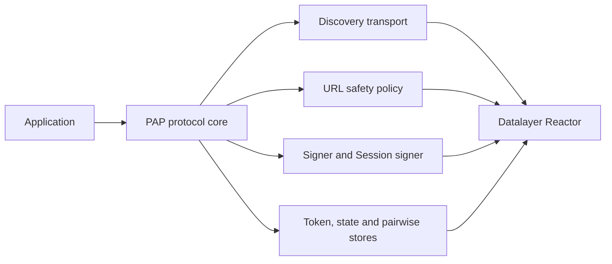

# Reactor-first architecture

Both SDKs use [Datalayer Reactor](https://reactor.datalayer.tech) as their
extension runtime. The protocol boundary owns mandatory validation and
security rules; plugins provide replaceable infrastructure and optional PAP
extensions.

Every replaceable service is a contribution point, the same in Python and
TypeScript: [Contribution points](/concepts/contribution-points/) lists them
with their defaults and which are tenant-scoped.

Lower `order` values have higher priority. Equal winning priorities fail
closed instead of selecting a provider by load order.

## What remains in the protocol core

Reactor makes infrastructure replaceable; it does not make protocol invariants
optional. Parsing, version compatibility, domain and issuer binding, secret
redaction, token/resource binding, replay protection, and exact revision
approval remain owned by the PAP core.

Applications may supply an existing Reactor host so PAP participates in the
same plugin lifecycle as the rest of their platform. Otherwise each SDK can
assemble a host with safe defaults.

## Two meanings of extension

A **PAP extension** is negotiated on the wire by name and major version. A
**Reactor extension** packages plugins and manages their lifecycle. The SDK
implements two PAP extensions, Operations version 2 and Mediated Sign-In version
1; see
[Extensions](/guides/extensions/).

Plugins cannot turn off domain/issuer binding, secret redaction, token/resource
binding, replay protection, or exact operation-revision approval.

See [Extensions](/guides/extensions/) for the relationship between negotiated
wire capabilities and runtime plugins.
