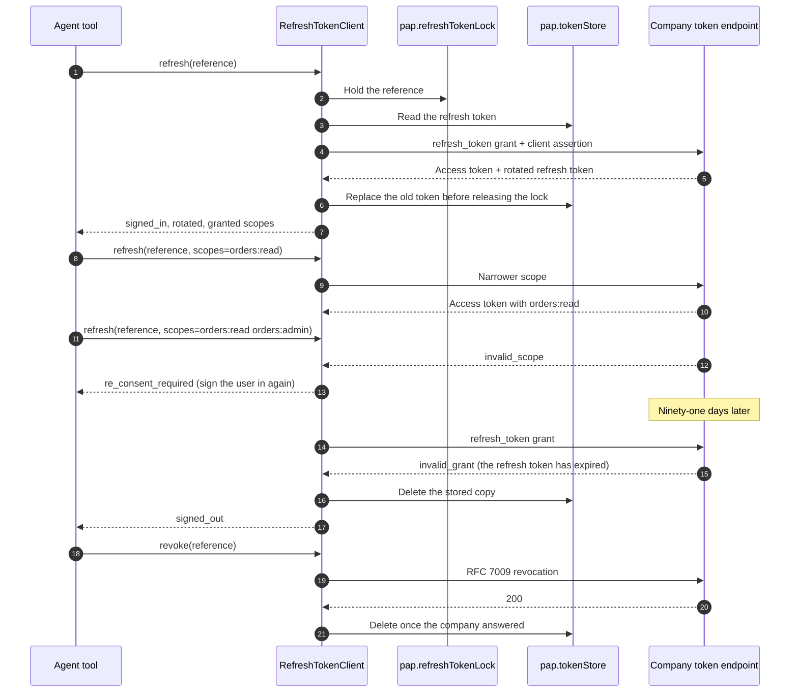

import Deck from '@theme/Deck';
import deck from '@site/decks/examples/account-tokens.deck.json';

# Refresh tokens

<Deck spec={deck} />

A sign-in returns a refresh token, which earlier drafts called the Account Token.
The personal agent uses it only at the company's token and revocation endpoints,
to get a new access token when a short-lived one expires. It isn't tied to a
Session: any of the User's Sessions can use the access tokens it gets. The paired
examples run the real `RefreshTokenClient` against Manzanita Outfitters, the
reference company in `personal_agent_protocol.demo`, with real keys over HTTP
in one process.

The walkthrough:

1. **Refresh** gets a new access token, and the company rotates the refresh token.
   The refresh names no Session, so another of the User's Sessions uses the new
   access token as well. The new refresh token replaces the old one in the token
   store before the call returns.
2. **Two refreshes at once** both succeed: the Reactor `pap.refreshTokenLock`
   serializes them, so the second presents the token the first rotated in, not
   the one the company already revoked.
3. **Narrower** scopes are granted; **wider** scopes come back as
   `re_consent_required`, a decision for the user, never a retry.
4. Ninety-one days later the refresh token has **expired**: `invalid_grant`, the
   SDK deletes the stored copy, and the status is `signed_out`. The Sessions go on
   signed out, sending the Session header alone.
5. **Revocation** ends the sign-in. An access token still in hand is
   `invalid_token`, and the Session goes on signed out by sending no token. The
   next question to the company draws an `authorization` event again
   (`insufficient_scope`).

Sign-out is `sign_out(references)`: it revokes every refresh token held for the
account, and the account is signed out once none is valid.

A token for one service, such as an MCP server, comes from a refresh with
`resource` set to the server's URL: `token_for_mcp(reference, context=..., server=...)`,
with `server` the metadata `fetch_mcp_server_metadata` returns. MCP's baseline is
Bearer: a proof goes only when that metadata lists ES256, whatever the issuer lists.

The model sees statuses (`signed_in`, `re_consent_required`, `signed_out`),
whether a rotation happened, and scope names. The refresh token, access tokens,
client assertions, and Session JWTs stay host-only, behind opaque references in
Reactor stores.

TypeScript has the same client: `new RefreshTokenClient({ reactor, fetch })`,
with `refresh(reference, { context, scopes })`, `revoke()`, and `signOut()`, and the
lock contributed at `RefreshTokenLocks`.

- Run the [Pydantic AI example](https://github.com/datalayer/personal-agent-protocol/tree/main/examples/pydantic-ai/account-tokens).
- Run the [Agent Runtimes example](https://github.com/datalayer/agent-runtimes/tree/main/examples/personal-agent-protocol/account-tokens).
- Read the [refresh tokens guide](/guides/account-tokens/).
