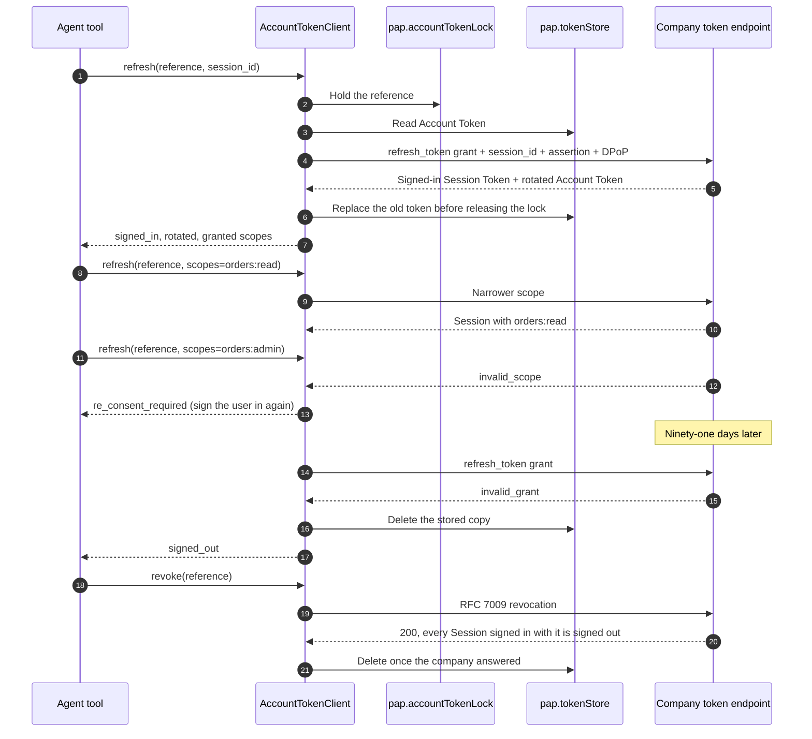

# Account Tokens

A sign-in returns an Account Token (the OAuth `refresh_token`). The personal
agent uses it only at the company's token and revocation endpoints, to sign a
Session in again after its short-lived Session Token expires. The paired
examples run the real `AccountTokenClient` against Manzanita Outfitters, the
reference company in `personal_agent_protocol.demo`, with real keys over HTTP
in one process.

The walkthrough:

1. **Refresh** signs the same Session in again (`session_id` unchanged) and the
   company rotates the token. The new one replaces the old in the token store
   before the call returns.
2. **Two refreshes at once** both succeed: the Reactor `pap.accountTokenLock`
   serializes them, so the second presents the token the first rotated in, not
   the one the company already revoked.
3. **Narrower** scopes are granted; **wider** scopes come back as
   `re_consent_required`, a decision for the user, never a retry.
4. An **expired** token draws `invalid_grant`; the SDK deletes it and the
   Session continues signed out.
5. **Revocation** signs out every Session signed in with the token. The next
   question to the company draws an `authorization` event again.

The model sees statuses (`signed_in`, `re_consent_required`, `signed_out`),
whether a rotation happened, and scope names. The Account Token, Session
Tokens, client assertions, and DPoP proofs stay host-only, behind opaque
references in Reactor stores.

TypeScript has the same client: `new AccountTokenClient({ reactor, fetch })`,
with `refresh(reference, { context, sessionId, scopes })` and `revoke()`, and
the lock contributed at `AccountTokenLocks`.

- Run the [Pydantic AI example](https://github.com/datalayer/personal-agent-protocol/tree/main/examples/pydantic-ai/account-tokens).
- Run the [Agent Runtimes example](https://github.com/datalayer/agent-runtimes/tree/main/examples/personal-agent-protocol/account-tokens).
- Read the [Account Tokens guide](/guides/account-tokens/).
