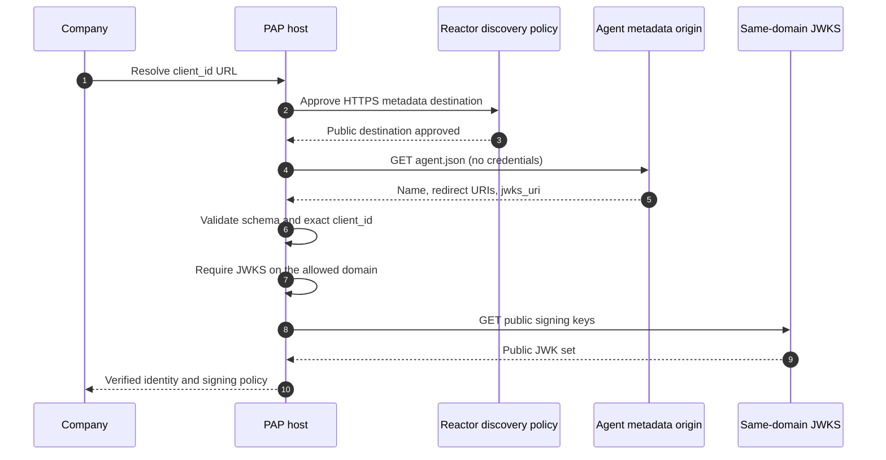

import Deck from '@theme/Deck';
import deck from '@site/decks/examples/agent-identity.deck.json';

# Personal-agent identity

<Deck spec={deck} />

A company needs a stable way to identify the software acting for a user. The
agent's HTTPS `client_id` points to public metadata describing its name,
redirect URIs, and JWKS location. The company verifies that metadata before it
accepts signed assertions; the private signing key never leaves its custodian.

## What the example proves

- Agent metadata and JWKS are public, credential-free resources.
- The declared identity must match the URL that was requested.
- Redirect URIs are explicit rather than inferred from an incoming callback:
  HTTPS on the `client_id`'s domain, or loopback (`http://127.0.0.1:{port}`,
  `http://[::1]:{port}`) for an app on the user's computer, matched whatever
  the port (RFC 8252 §7.3).
- JWKS domain policy prevents an identity document from silently delegating
  trust to an unrelated key host.
- Tool output describes policy; key coordinates and raw metadata remain outside
  model context.

Run the [Pydantic AI example](https://github.com/datalayer/personal-agent-protocol/tree/main/examples/pydantic-ai/agent-identity)
or the [Agent Runtimes example](https://github.com/datalayer/agent-runtimes/tree/main/examples/personal-agent-protocol/agent-identity).
Continue with [Delegation](./delegation) and the
[personal-agent guide](/guides/personal-agent/).
