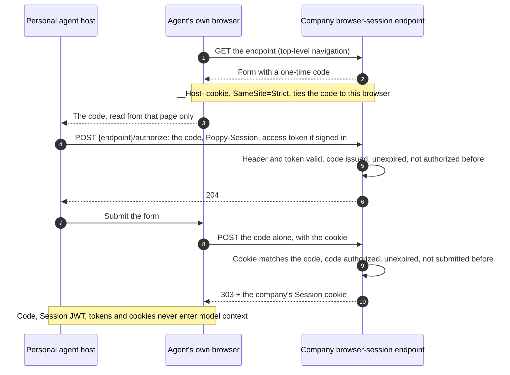

import Deck from '@theme/Deck';
import deck from '@site/decks/examples/browser-session.deck.json';

# Browser Session

<Deck spec={deck} />

PAP can carry one Session across APIs, conversations, and the company's
website. When discovery advertises `web.browser_session_endpoint`, the personal
agent's own browser joins the Session through a form on that page (§6): the
page gives the browser a one-time code, the personal agent authorizes the code
in a request of its own, with the Session header and the access token if signed
in, and the browser submits the form. The company answers with its own cookie
for the Session. Only the browser that loaded the page can submit its code, and
only an agent that can sign for the Session can authorize it. The access token
never passes through the browser.



## Personal-agent responsibilities

- Join the browser before browsing a website that lists the endpoint; on a
  website without one, browse as an ordinary signed-out visitor.
- Load the endpoint with a GET as a top-level navigation, in a browser the
  agent controls, never the user's ordinary browser.
- Take the code **only** from the page its own browser loaded from the
  endpoint, never from a message, a conversation, or another page: a code from
  anywhere else may come from someone else's browser, which would then join
  the user's Session (§9.6).
- Authorize the code at `{endpoint}/authorize`, with the Session header of the
  Session the browser joins and, if signed in, the access token the website
  should act with. The browser never sees either.
- Read the code and authorize it in host code the model can't read (§10.2).
- After an error, start again from the GET. The agent may join again at any
  time; each join replaces the company's earlier cookie.

`BrowserSessionClient.join(browser_session_endpoint=..., session=..., token=...)`
resolves the clock and the agent's browser through Reactor: the browser is the
host's `pap.browserJoin` contribution (`BrowserJoins` in TypeScript), whose
`load_join_form(endpoint)` returns the code as a secret and `submit_join_form()`
posts it from the same browser. The client refuses a code shorter than 128 bits
(`invalid_join_code`), sends the `/authorize` request through its
`SessionHttpClient`, and returns only the endpoint and when the browser joined.

In TypeScript, the agent joins its browser to the Session, signed in with the
account's access token or signed out, then browses the company's website in it.
`BrowserSessionClient` takes the transport that sends the Session header, and
the `pap.browserJoin` contribution (`loadJoinForm(endpoint)`,
`submitJoinForm()`) gives it the code from the agent's own browser and submits
the form, the code alone:

```typescript
import { BrowserSessionClient, SessionFetchClient } from "@datalayer/personal-agent-protocol";

const transport = new SessionFetchClient({ reactor });
await new BrowserSessionClient({ reactor, transport }).join({
  browserSessionEndpoint: company.document.web!.browser_session_endpoint!,
  session,
  token,
});
await browser.get(`https://${company.document.organization.domain}/`);
```

## Company responsibilities

The page (step 1):

- a form with a hidden `code` (at least 128 random bits, expiring within 60
  seconds), posting to the endpoint;
- a cookie set in the same response that ties the code to this browser:
  `Secure`, `HttpOnly`, `SameSite=Strict`, with the `__Host-` prefix;
- `Cache-Control: no-store`, `Content-Security-Policy: frame-ancestors 'none'`,
  and `Cross-Origin-Opener-Policy: same-origin`;
- loading it starts, ends, or changes no Session and no other cookie.

The authorization (step 2) checks the Session header as at any resource, which
starts the Session if its `sid` is new, and the access token, if any. The code
must have been issued, be unexpired, and not be authorized before. The company
records it for that Session and, if signed in, for the token's account and
scopes, and answers `204`; otherwise `400` with `invalid_request`.

The submission (step 3) is accepted only when the cookie matches the code and the
code was authorized, is unexpired and has not been submitted before (a code is
used by the first request that submits it, whatever the result). Then the company
sets its Session cookie, clears the join cookie, and answers `303`; otherwise an
error status and no cookie.

The Session cookie is the company's own. It must be `Secure` and `HttpOnly`,
should use the `__Host-` prefix, must follow the Session's state (sign-in,
sign-out, and scope changes show on the next request), and must not outlive
the Session.

Both reference companies (Python and TypeScript, with `web` set in their
configuration) do this at `/poppy/browser-session`: the join cookie is
`__Host-poppy_join`, and the Session cookie `__Host-poppy_session` is
`Secure`, `HttpOnly` and `SameSite=Strict`, has no lifetime of its own, and
stands for the Session only while it is live, so signing out reaches the
website on its next request. The conformance cases
`lifecycle.browser-joins-session` and `lifecycle.browser-join-refused` cover them.

## What the example proves

The [Pydantic AI example](https://github.com/datalayer/personal-agent-protocol/tree/main/examples/pydantic-ai/browser-session)
runs against Manzanita with its website on. It joins the agent's browser
(`303` and the Session cookie; the form carries the code alone, and nothing of the
Session goes through the browser), then shows the two refusals §10.6 asks for: the
same code submitted again is refused, and a code the agent authorized, submitted
from another browser without its cookie, is refused and used up. Its tool result
holds statuses and booleans only.

See upstream [Web browsing](https://personalagentprotocol.org/docs/0.3/spec#web-browsing)
and [Joining a browser to a Session](https://personalagentprotocol.org/docs/0.3/spec#browser-join).
