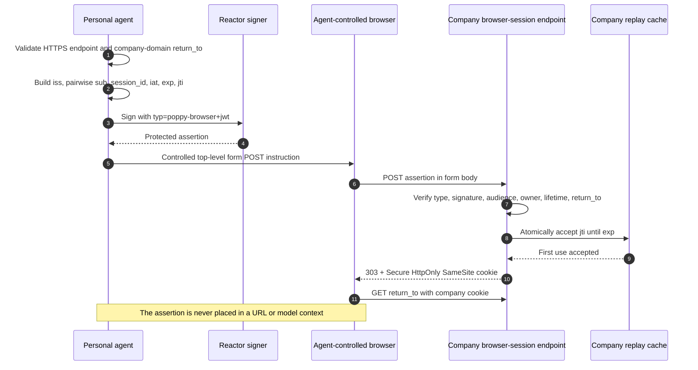

# Browser Session

PAP can carry one Session across APIs, conversations, and the company's
website. When discovery advertises `web.browser_session_endpoint`, the personal
agent signs a short-lived browser assertion and has a browser it controls POST
that assertion to the company. The company verifies it, sets its own Session
cookie, and redirects to the requested page.



## Personal-agent responsibilities

- Use the advertised HTTPS endpoint as the exact assertion audience.
- Set `return_to` only to the company's domain or one of its subdomains.
- Use the pairwise User ID and active Session ID that belong together.
- Limit `exp - iat` to at most 60 seconds and generate a unique, unpredictable
  `jti` with at least 128 bits of entropy.
- Sign with the distinct protected-header type `poppy-browser+jwt`.
- Submit `assertion` in a top-level form POST from a browser the agent controls.
  It must never appear in a query string or the user's ordinary browser.

`BrowserSessionClient` resolves clock, randomness, signing, and the controlled
form POST through Reactor. It returns only the endpoint, safe return location,
and expiry; the compact assertion never leaves the host boundary.

In TypeScript, the agent opens an operation's page in its own browser (the
host's `BrowserFormPosts` contribution, with its own cookie jar), after
`operationPage` has checked the page is on the company's domain:

```typescript
import { BrowserSessionClient, operationPage } from "@datalayer/personal-agent-protocol";

const domain = company.document.organization.domain;
const page = operationPage(operation, domain);
const joined = await new BrowserSessionClient({ reactor }).join({
  clientId,
  pairwiseUserId,
  browserSessionEndpoint: company.document.web!.browser_session_endpoint!,
  sessionId: session.sessionId,
  returnTo: page,
  companyDomain: domain,
});
console.log(joined.returnTo);
```

## Company responsibilities

`verify_browser_assertion` in Python and `verifyBrowserAssertion` from the
TypeScript `./server` entry check:

- ES256 or RS256 signature against the agent's verified JWKS;
- exact `poppy-browser+jwt` type and endpoint audience;
- a lifetime no longer than 60 seconds and an assertion active now;
- the expected client, pairwise User ID, active Session, and company-domain
  return target; and
- atomic one-use replay acceptance of `(client_id, jti)` until expiry.

After verification, the company creates its own cookie. That cookie must be
`Secure` and `HttpOnly`, use `SameSite=Lax` or `None`, follow later sign-in,
sign-out, and scope changes, and never outlive the PAP Session. Cookie creation
is intentionally a company web-framework responsibility rather than an SDK
side effect.

Both reference companies (Python and TypeScript, with `web` set in their
configuration) do this at `/poppy/browser-session`: the `poppy_session` cookie
is `Secure`, `HttpOnly` and `SameSite=Lax`, has no lifetime of its own, and
stands for the Session only while it is live, so signing out reaches the
website on its next request. Each operation's page (`/operations/{id}`) shows
it in that Session and confirms or cancels it through a same-site form with a
CSRF token bound to the cookie; the conformance cases
`lifecycle.browser-joins-session`, `lifecycle.browser-assertion-refused`, and
`operations.web-confirm-at-most-once` pass in all four language pairings.

## What the examples prove

Both examples create a real ES256 assertion, pass it through a Reactor form
POST contribution, verify it, and submit it a second time to demonstrate replay
rejection. Their tool results contain boolean policy evidence only.

Run the [Pydantic AI example](https://github.com/datalayer/personal-agent-protocol/tree/main/examples/pydantic-ai/browser-session)
or the [Agent Runtimes example](https://github.com/datalayer/agent-runtimes/tree/main/examples/personal-agent-protocol/browser-session).
See upstream [Web browsing](https://personalagentprotocol.org/docs/spec#web-browsing).
