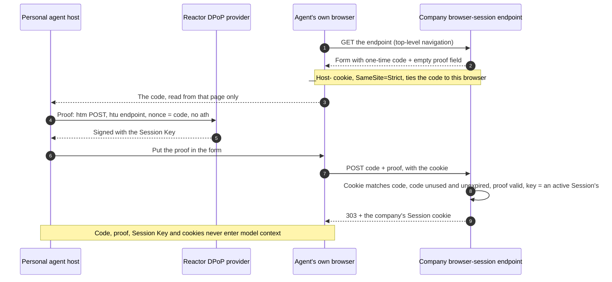

import Deck from '@theme/Deck';
import deck from '@site/decks/examples/browser-session.deck.json';

# Browser Session

<Deck spec={deck} />

PAP can carry one Session across APIs, conversations, and the company's
website. When discovery advertises `web.browser_session_endpoint`, the personal
agent's own browser joins the Session through a form on that page (§5): the
page gives the browser a one-time code, the personal agent signs a DPoP proof
over the code with its Session Key, and the browser submits the form. The
company answers with its own cookie for the Session. Only the browser that
loaded the page can submit its code, and only the agent that holds the Session
Key can sign the proof, so no one else can make a browser join the Session.



## Personal-agent responsibilities

- Join the browser before browsing a website that lists the endpoint; on a
  website without one, browse as an ordinary signed-out visitor.
- Load the endpoint with a GET as a top-level navigation, in a browser the
  agent controls, never the user's ordinary browser.
- Take the code **only** from the page its own browser loaded from the
  endpoint, never from a message, a conversation, or another page: a code from
  anywhere else may come from someone else's browser, which would then join
  the user's Session (§9.6).
- Sign the proof with the Session Key of the Session the browser joins, signed
  in or out: `htm` `POST`, `htu` the endpoint, `nonce` the code, no `ath`.
- Read the code and sign the proof in host code the model can't read (§9.2).
- After an error, start again from the GET. The agent may join again at any
  time; each join replaces the company's earlier cookie.

`BrowserSessionClient.join(browser_session_endpoint, tenant_id, issuer,
session_key)` resolves the clock, the DPoP provider, and the agent's browser
through Reactor: the browser is the host's `pap.browserJoin` contribution
(`BrowserJoins` in TypeScript), whose `load_join_form(endpoint)` returns the
code as a secret and `submit_join_form(proof)` posts it from the same browser.
The client refuses a code shorter than 128 bits (`invalid_join_code`) and
returns only the endpoint and when the browser joined.

In TypeScript, the agent joins its browser to the Session, signed in with the
account's access token or signed out, then browses the company's website in it.
`BrowserSessionClient` takes the transport that sends the Session header, and
the `pap.browserJoin` contribution (`loadJoinForm(endpoint)`,
`submitJoinForm()`) gives it the code from the agent's own browser and submits
the form, the code alone:

```typescript
import { BrowserSessionClient, SessionFetchClient } from "@datalayer/personal-agent-protocol";

const transport = new SessionFetchClient({ reactor });
await new BrowserSessionClient({ reactor, transport }).join({
  browserSessionEndpoint: company.document.web!.browser_session_endpoint!,
  session,
  token,
});
await browser.get(`https://${company.document.organization.domain}/`);
```

## Company responsibilities

The page (step 1):

- a form with a hidden `code` (at least 128 random bits, expiring within 60
  seconds) and an empty `proof` field, posting to the endpoint;
- a cookie set in the same response that ties the code to this browser:
  `Secure`, `HttpOnly`, `SameSite=Strict`, with the `__Host-` prefix;
- `Cache-Control: no-store`, `Content-Security-Policy: frame-ancestors 'none'`,
  and `Cross-Origin-Opener-Policy: same-origin`;
- loading it starts, ends, or changes no Session and no other cookie.

The submission (step 3) is accepted only when the cookie matches the code; the
code was issued, is unexpired and unused (a code is used by the first request
that sends it, whatever the result); the proof is a valid DPoP proof for this
POST with the code as `nonce`; and its key is an active Session's. A key the
company doesn't know is an error here, never a new Session. Then the company
sets its Session cookie, clears the join cookie, and answers `303`; otherwise
`400` (or `429`) and no cookie.

The Session cookie is the company's own. It must be `Secure` and `HttpOnly`,
should use the `__Host-` prefix, must follow the Session's state (sign-in,
sign-out, and scope changes show on the next request), and must not outlive
the Session.

Both reference companies (Python and TypeScript, with `web` set in their
configuration) do this at `/poppy/browser-session`: the join cookie is
`__Host-poppy_join`, and the Session cookie `__Host-poppy_session` is
`Secure`, `HttpOnly` and `SameSite=Strict`, has no lifetime of its own, and
stands for the Session only while it is live, so signing out reaches the
website on its next request. Each operation's page (`/operations/{id}`) shows
it in that Session and confirms or cancels it through a same-site form with a
CSRF token bound to the cookie; the conformance cases
`lifecycle.browser-joins-session`, `lifecycle.browser-join-refused`, and
`operations.web-confirm-at-most-once` cover them.

## What the example proves

The [Pydantic AI example](https://github.com/datalayer/personal-agent-protocol/tree/main/examples/pydantic-ai/browser-session)
runs against Manzanita with its website on. It joins the agent's browser
(`303` and the Session cookie; the proof's key is the Session Key and its
nonce the code), then shows the two refusals §9.6 asks for: the same code
submitted again with a fresh valid proof is refused, and a code the agent's
browser loaded, submitted from another browser without its cookie, is refused
and used up. Its tool result holds statuses and booleans only.

See upstream [Web browsing](https://personalagentprotocol.org/docs/0.3/spec#web-browsing)
and [Joining a browser to a Session](https://personalagentprotocol.org/docs/0.3/spec#browser-join).
