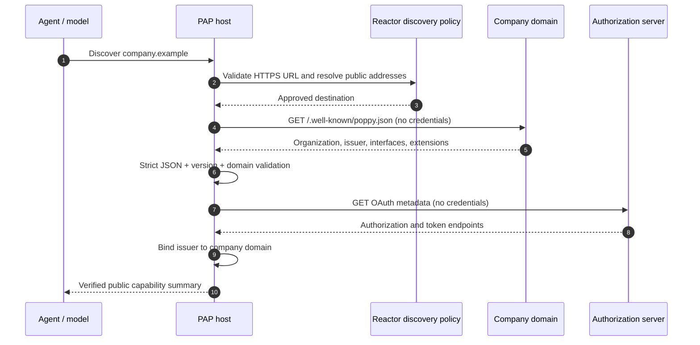

import Deck from '@theme/Deck';
import deck from '@site/decks/examples/company-discovery.deck.json';

# Company discovery

<Deck spec={deck} />

Discovery turns a company domain into verified, public PAP metadata. The
personal agent fetches `/.well-known/poppy.json`, validates the document and
supported protocol version, then follows the advertised OAuth metadata. No
Session Token, cookie, assertion, or user identifier belongs on these requests.

## What the example proves

- Only HTTPS, public-network destinations are eligible.
- Redirects, response sizes, content types, duplicate JSON members, domains,
  versions, and issuer relationships are checked before data is trusted.
- The tool result contains a capability inventory, not raw response bodies.
- Discovery is credential-free, which prevents accidental token forwarding to
  an unverified host.

Validation before a later, independent DNS lookup is not sufficient
protection against rebinding, so the Python SDK pins the connection: the URL
safety policy returns the addresses it approved (`ApprovedUrl`), and the
default transport dials only those, never resolving the host again, while TLS
still verifies the host name. The TypeScript SDK checks addresses but does not
yet pin the socket: pair it with an egress proxy that enforces the same
decision.

Run the [Pydantic AI example](https://github.com/datalayer/personal-agent-protocol/tree/main/examples/pydantic-ai/company-discovery)
or the [Agent Runtimes example](https://github.com/datalayer/agent-runtimes/tree/main/examples/personal-agent-protocol/company-discovery).
Continue with [Personal-agent identity](./agent-identity) and the
[company implementation guide](/guides/company/).
