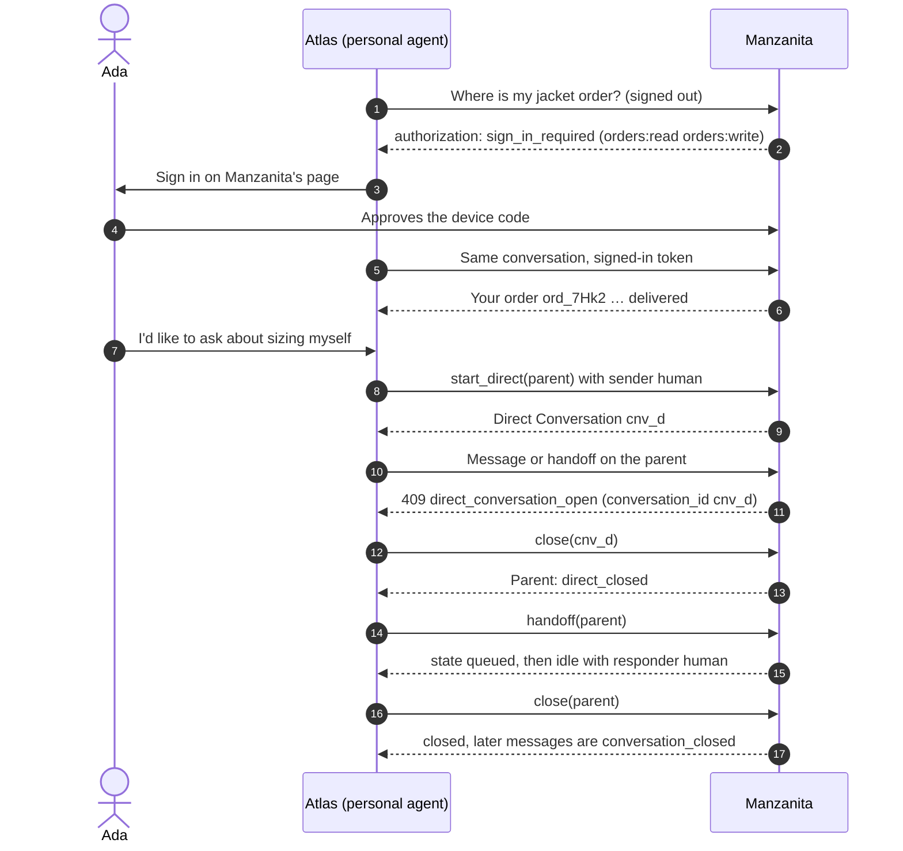

import Deck from '@theme/Deck';
import deck from '@site/decks/examples/conversation-control.deck.json';

# Conversation control

<Deck spec={deck} />

A conversation is more than messages. The company can ask the user to sign in
part-way through, the user can talk to the company directly through the
agent's interface, either side can bring in a person, and the agent can close
it. The paired examples drive one Manzanita conversation through all four,
against a Manzanita with a support desk staffed.

- **Sign-in mid-conversation (§7.11).** An `authorization` event says what is
  missing (`sign_in_required` or `insufficient_scope`) and which scopes. The
  host signs in with any mode the company offers and keeps sending to the
  **same conversation ID** with the new token.
- **Direct Conversations (§7.10).** Only the personal agent starts one, for
  the user to talk with the company in the agent's interface. While it is
  open, the parent refuses messages and handoff with
  `direct_conversation_open`; the SDK puts the open conversation's ID in
  `error.details["conversation_id"]`.
- **Handoff (§7.9).** `handoff()` asks for a person; the conversation is
  `queued` until one takes it, then `responder` is `human`. When no one is
  available the company says so and the agent continues.
- **Closing (§7.12).** `close()` ends the conversation; operations it
  proposed or started are not cancelled.

The model sees event types, statuses, the company's answers, and error codes.
Tokens, the device code, and proofs stay host-only; the user code is shown to
the user by the host, not by the model.

TypeScript: `startDirect()`, `handoff()`, and `close()` on
`ConversationClient`, with the same error codes and details.

- Run the [Pydantic AI example](https://github.com/datalayer/personal-agent-protocol/tree/main/examples/pydantic-ai/conversation-control).
- Run the [Agent Runtimes example](https://github.com/datalayer/agent-runtimes/tree/main/examples/personal-agent-protocol/conversation-control).
- Read the [conversations guide](/guides/conversations/).
