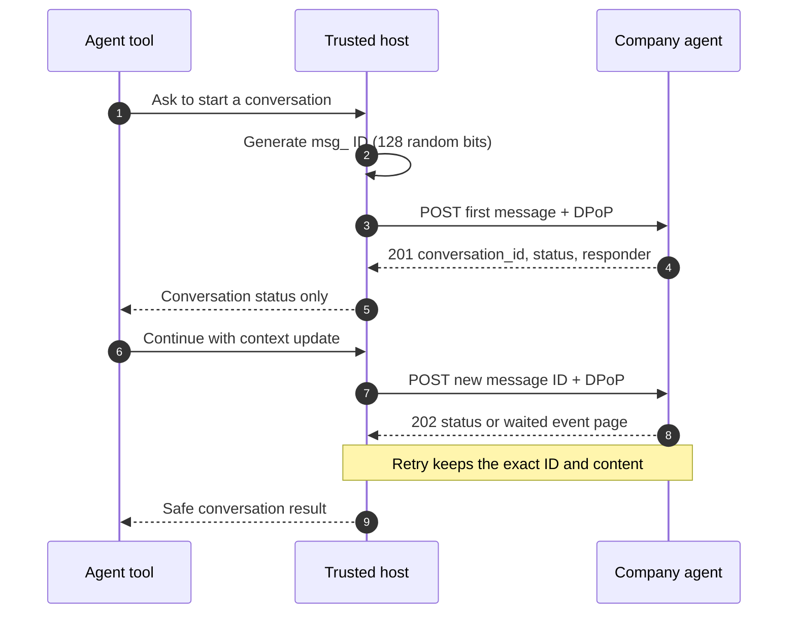

# Conversation messages

PAP message IDs are user-global idempotency keys. Generate one with at least
128 random bits, retain the complete `Message`, and retry that same object after
an ambiguous network failure. Reusing its ID with different content is a
`message_id_conflict`.

Python and TypeScript both expose `ConversationClient`. It validates opaque
IDs, supports `text`, `data`, and
`context`, bounds response bodies, rejects duplicate JSON members, surfaces
company error codes without including response bodies, and can request replies
with `cursor` and `wait`. Authentication remains in `DpopHttpClient` and never
enters model-visible tool inputs or results.

TypeScript additionally propagates caller-owned `AbortSignal` cancellation.
Event reading, SSE, handoff, Direct Conversations, authorization changes, and
closure remain separate milestones.

Run the [Pydantic AI example](https://github.com/datalayer/personal-agent-protocol/tree/main/examples/pydantic-ai/conversation-messages).
See upstream [Conversations](https://personalagentprotocol.org/docs/spec#7-conversations).
