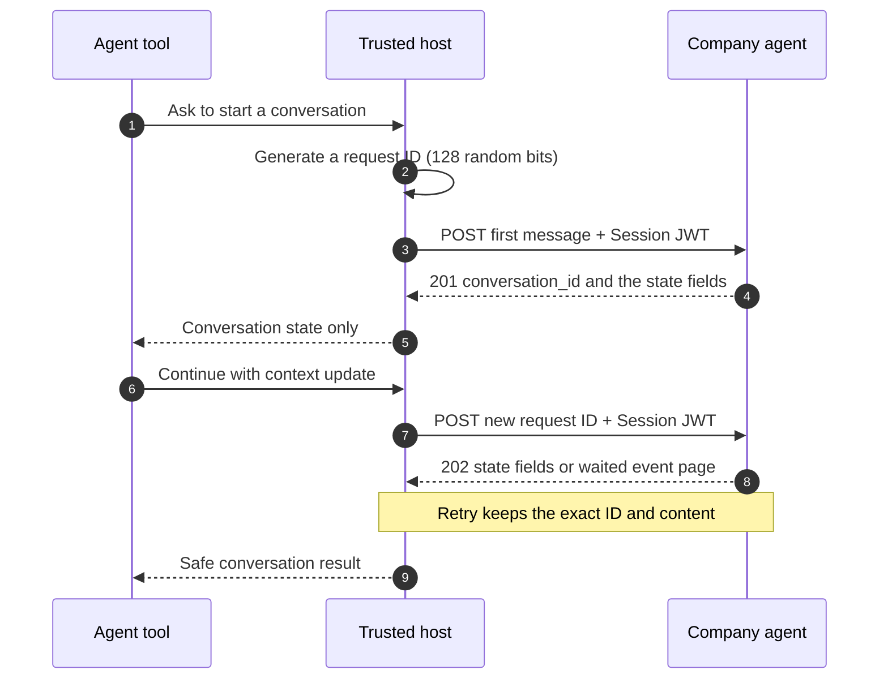

import Deck from '@theme/Deck';
import deck from '@site/decks/examples/conversation-messages.deck.json';

# Conversation messages

<Deck spec={deck} />

Every conversation `POST` carries a request `id` (§8.3), a user-global
idempotency key the personal agent chooses; a message's ID is its request's, so
the message itself goes without one. Generate one with at least 128 random
bits (`generate_request_id`, `generateRequestId`), retain the complete `Message`
whose `id` holds it, and retry that same object after an ambiguous network
failure: the same ID to the same path with the same body returns the original
response. Reusing the ID with another body, or at another path, is a
`request_id_conflict`. A successful `POST` means the company accepted the
request, not that it acted on it: the response without `wait` holds only
`conversation_id`, and the state is read (§8.7).

Each message names its `author`: `{"type": "agent"}` for what the personal
agent writes itself, `{"type": "human"}` only for the words a person typed in
a Direct Conversation. Python and TypeScript both expose `ConversationClient`.
It validates opaque IDs, supports `text`, `data`, and
`context`, bounds response bodies, rejects duplicate JSON members, surfaces
company error codes without including response bodies, and can request replies
with `cursor` and `wait`. Authentication remains in `SessionHttpClient` and never
enters model-visible tool inputs or results.

TypeScript additionally propagates caller-owned `AbortSignal` cancellation.
Ordered JSON event reads are in the
[conversation events flow](./conversation-events); SSE, handoff, Direct
Conversations, sign-in mid-conversation, and closing in the
[streaming](./conversation-streaming) and
[control](./conversation-control) flows.

Run the [Pydantic AI example](https://github.com/datalayer/personal-agent-protocol/tree/main/examples/pydantic-ai/conversation-messages).
See upstream [Conversations](https://personalagentprotocol.org/docs/0.4/spec#conversations).
