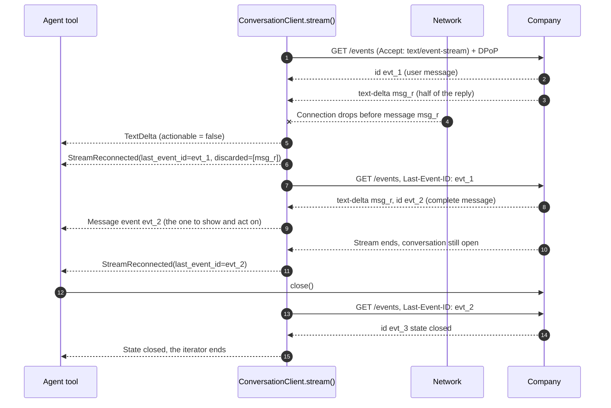

# Conversation streaming

A company that streams answers `GET …/events` with `Accept: text/event-stream`.
Events arrive as SSE frames with their IDs, and `text-delta` frames carry a
message while it is still being written. The paired examples stream a
Manzanita conversation through a connection that breaks in the middle of the
company's first reply.

What the stream guarantees:

- **Deltas are display only.** `TextDelta.actionable` is always `False`; the
  complete `message` event replaces the pieces. A host routes deltas to a
  typing indicator, never to anything that acts.
- **Reconnects resume.** When the company ends the stream, the SDK reopens it
  with `Last-Event-ID` set to the last event handled, and yields
  `StreamReconnected` so the UI knows.
- **Partial messages are discarded.** Pieces whose complete message never
  arrived are listed in `discarded_message_ids`, so the display drops them.
- **No event twice.** Replayed events are suppressed by ID, within a bounded
  set that fails closed.
- **Bounded retries.** After `max_reconnects` reconnects in a row without a
  new event, the stream fails with `stream_unavailable`. A company that does
  not stream answers JSON; the SDK raises `sse_unsupported` and the host falls
  back to the long-polling `events()` reader.

The model sees the company's complete messages, how many deltas and
reconnects there were, and that nothing was delivered twice. The Session
Token, DPoP proofs, and pairwise identity stay host-only.

TypeScript: `for await (const item of client.stream(endpoint, id, options))`,
where `item.kind` is `"text-delta"` or `"reconnected"` for the two
stream-only items.

- Run the [Pydantic AI example](https://github.com/datalayer/personal-agent-protocol/tree/main/examples/pydantic-ai/conversation-streaming).
- Run the [Agent Runtimes example](https://github.com/datalayer/agent-runtimes/tree/main/examples/personal-agent-protocol/conversation-streaming).
- Read the [conversations guide](/guides/conversations/).
