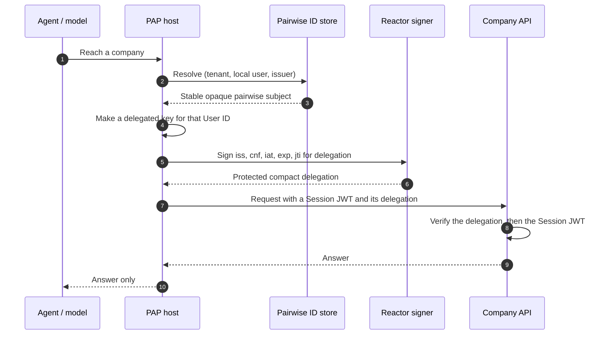

import Deck from '@theme/Deck';
import deck from '@site/decks/examples/delegation.deck.json';

# Delegation

<Deck spec={deck} />

A delegation lets a key from the agent's `jwks_uri` vouch for a short-lived
delegated key, which then signs each request's Session JWT. It identifies the
agent in `iss` and the delegated public key in `cnf.jwk`, and expires quickly. It
says nothing about the User or the Company: no User ID, no Agent ID, no issuer.

## What the example proves

- The delegation's claims are `iss`, `cnf`, `iat`, `exp` and `jti`: it names no
  User and no Company, and those belong to the Session JWT it vouches for.
- The subject is pairwise: two companies cannot correlate a user by comparing
  PAP identifiers. A delegated key is never shared by two User IDs.
- `iat` and `exp` bound its useful lifetime, at most 24 hours.
- Signing happens through a Reactor capability; private keys and compact
  delegations never become tool arguments or model output.

The small example stops at the delegation's claims. The [Session lifecycle
example](./session-lifecycle) sends a Session JWT with its delegation on each
request.

Run the [Pydantic AI example](https://github.com/datalayer/personal-agent-protocol/tree/main/examples/pydantic-ai/delegation)
or the [Agent Runtimes example](https://github.com/datalayer/agent-runtimes/tree/main/examples/personal-agent-protocol/delegation).
