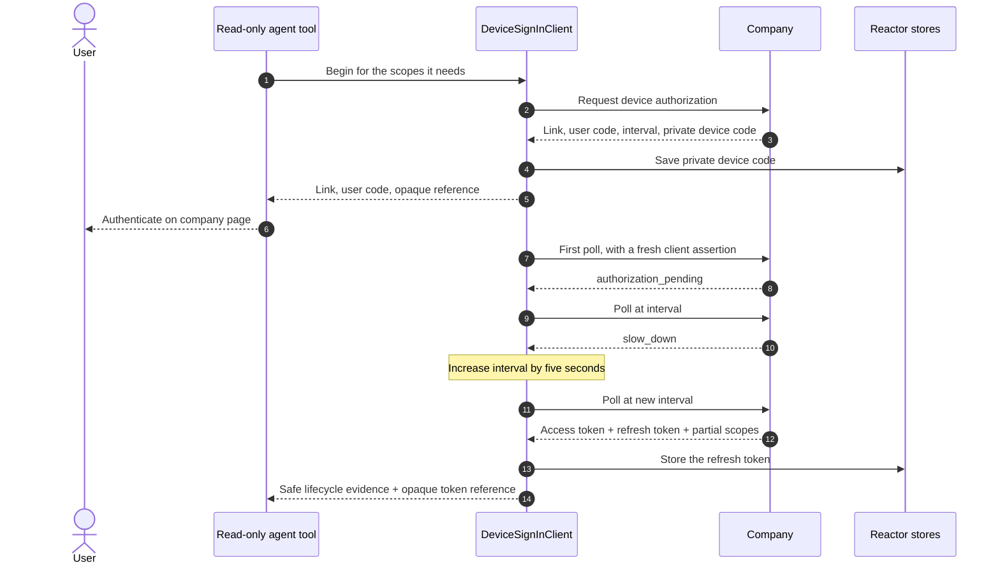

import Deck from '@theme/Deck';
import deck from '@site/decks/examples/device-sign-in.deck.json';

# Device Sign-In

<Deck spec={deck} />

The paired examples use the real SDK state machine against a deterministic
company transport. They demonstrate a terminal-style personal agent that
cannot receive a browser callback.

The model sees that the link and code were presented, early polling was
suppressed, pending and slow-down responses were respected, every network poll
carried a fresh client assertion, and one requested scope was omitted. The sign-in
names no Session: any Session is signed in by sending the access token. The link is
shown only because its host is the issuer's or one of the issuer's
`protected_resources`. It never sees the device code, assertions, or tokens.

- Run the [Pydantic AI example](https://github.com/datalayer/personal-agent-protocol/tree/main/examples/pydantic-ai/device-sign-in).
- Run the [Agent Runtimes example](https://github.com/datalayer/agent-runtimes/tree/main/examples/personal-agent-protocol/device-sign-in).
- Read the production [Device Sign-In guide](/guides/device-sign-in/).
