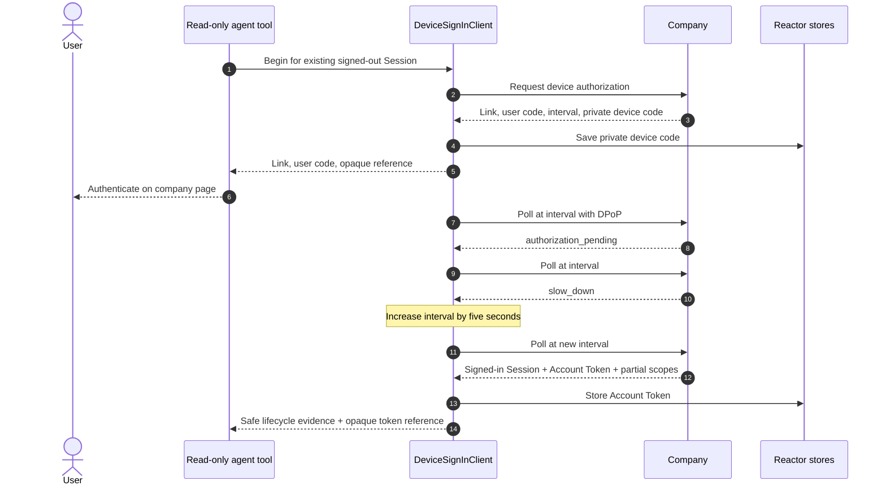

# Device Sign-In

The paired examples use the real SDK state machine against a deterministic
company transport. They demonstrate a terminal-style personal agent that
cannot receive a browser callback.

The model sees that the link and code were presented, early polling was
suppressed, pending and slow-down responses were respected, the original
Session was upgraded, and one requested scope was omitted. It never sees the
device code, assertions, proofs, or tokens.

- Run the [Pydantic AI example](https://github.com/datalayer/personal-agent-protocol/tree/main/examples/pydantic-ai/device-sign-in).
- Run the [Agent Runtimes example](https://github.com/datalayer/agent-runtimes/tree/main/examples/personal-agent-protocol/device-sign-in).
- Read the production [Device Sign-In guide](/guides/device-sign-in/).
