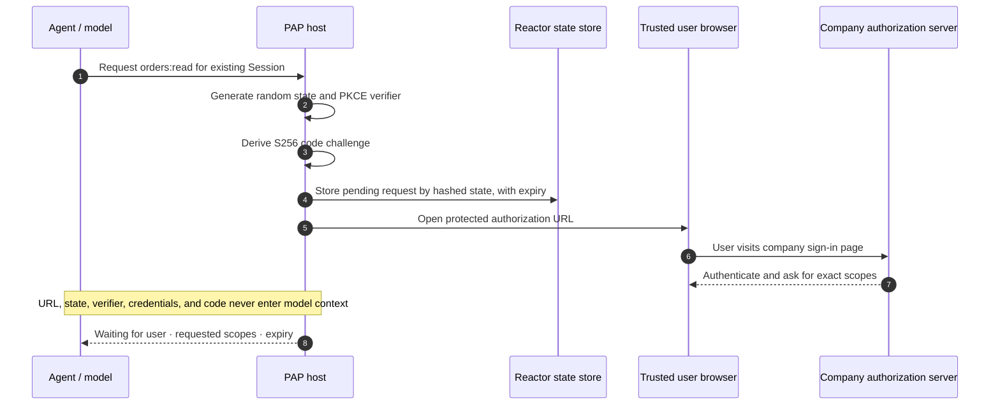

import Deck from '@theme/Deck';
import deck from '@site/decks/examples/direct-sign-in-boundary.deck.json';

# Direct Sign-In boundary

<Deck spec={deck} />

Direct Sign-In upgrades an existing signed-out Session. The personal agent may
explain why authorization is needed, but the host—not the model—constructs the
OAuth request, stores one-use state, and opens the company's page in a trusted
browser.

## What the example proves

- State and the verifier come from cryptographically secure randomness.
- Only the S256 challenge crosses to the authorization endpoint.
- The full authorization URL is a secret because it contains state and user
  intent; it is revealed only to the browser handoff capability.
- The state store must expire entries and support atomic consumption later.
- The company owns the sign-in UI, so the personal agent never receives the
  user's password.

This example deliberately ends at the browser boundary. Continue with the
[complete Direct Sign-In lifecycle](./direct-sign-in-lifecycle) for callback
validation and token exchange.

Run the [Pydantic AI example](https://github.com/datalayer/personal-agent-protocol/tree/main/examples/pydantic-ai/direct-sign-in-boundary)
or the [Agent Runtimes example](https://github.com/datalayer/agent-runtimes/tree/main/examples/personal-agent-protocol/direct-sign-in-boundary).
