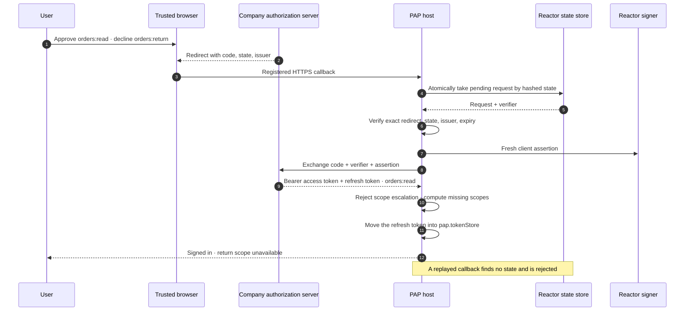

import Deck from '@theme/Deck';
import deck from '@site/decks/examples/direct-sign-in-lifecycle.deck.json';

# Direct Sign-In lifecycle

<Deck spec={deck} />

The complete flow resumes after the user authorizes on the company's page. The
host consumes the pending state exactly once, verifies the callback, and exchanges
the code with PKCE and a client assertion. The answer is plain OAuth: an access
token and a refresh token. Sign-in doesn't know the Session: a Session is signed in
on each request that carries the access token. Partial consent is an ordinary
result, not an excuse to silently widen access.

## What the example proves

- Callback state is consumed before exchange, so denial, failure, and success
  cannot leave replayable state behind.
- Redirect location, issuer, state, expiry, content type, response size, token
  type, and scopes are all validated. The company lists no DPoP algorithm here, so
  no proof goes, and a `DPoP` token type would be refused.
- Neither the authorization URL nor the code exchange names a Session: one sign-in
  can serve several Sessions.
- The company cannot return scopes the user did not request. Missing scopes are
  reported so the application can degrade safely or explain the limitation.
- The refresh token moves into the host's `pap.tokenStore` before `complete()`
  returns: the result carries only `refresh_token_reference`, and its `token`
  has no `refresh_token`. Access and refresh tokens do not enter URLs, logs,
  analytics, React state, or model transcripts.

The example intentionally grants only `orders:read` from a request for both
read and return access. It also submits the callback twice and reports that the
second attempt was rejected.

Run the [Pydantic AI example](https://github.com/datalayer/personal-agent-protocol/tree/main/examples/pydantic-ai/direct-sign-in-lifecycle)
or the [Agent Runtimes example](https://github.com/datalayer/agent-runtimes/tree/main/examples/personal-agent-protocol/direct-sign-in-lifecycle).
See the detailed [Direct Sign-In guide](/guides/direct-sign-in/).
