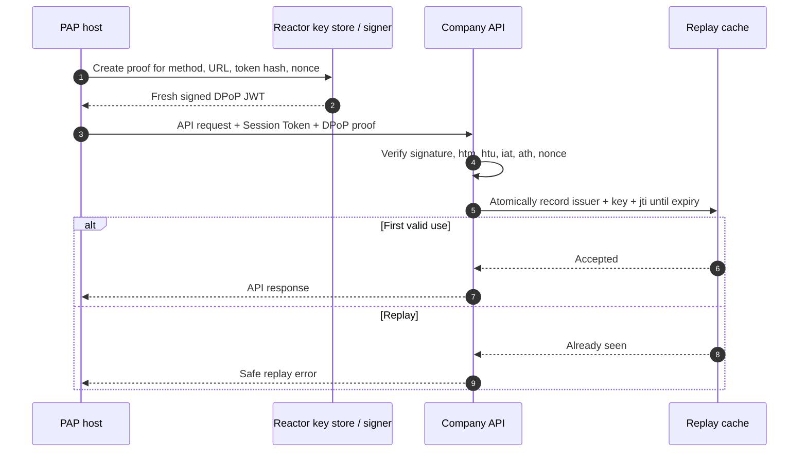

import Deck from '@theme/Deck';
import deck from '@site/decks/examples/dpop-proof.deck.json';

# DPoP proof

<Deck spec={deck} />

Demonstrating Proof of Possession (DPoP) prevents a stolen bearer value from
being sufficient on its own. For every request, the host signs a fresh proof
covering the normalized HTTP method and URL. When an access token is present,
the proof also carries its hash; a company nonce can add server-provided
freshness.

## What the example proves

- A new `jti` and proof are required for every attempt, retry, and redirect.
- `htm` and normalized `htu` prevent reuse on another request target.
- `ath` binds the proof to the token without embedding that token in the JWT.
- Nonce challenges are handled by generating a fresh proof, never by mutating
  or replaying the old one.
- Replay protection is a server responsibility and must be atomic across the
  company's serving fleet.

The example creates and verifies a real ES256 proof, then attempts to verify it
again to demonstrate rejection. Its model-visible result contains policy
booleans only.

Run the [Pydantic AI example](https://github.com/datalayer/personal-agent-protocol/tree/main/examples/pydantic-ai/dpop-proof)
or the [Agent Runtimes example](https://github.com/datalayer/agent-runtimes/tree/main/examples/personal-agent-protocol/dpop-proof).
See [JOSE and DPoP](/guides/cryptography/) for production key and replay-store requirements.
