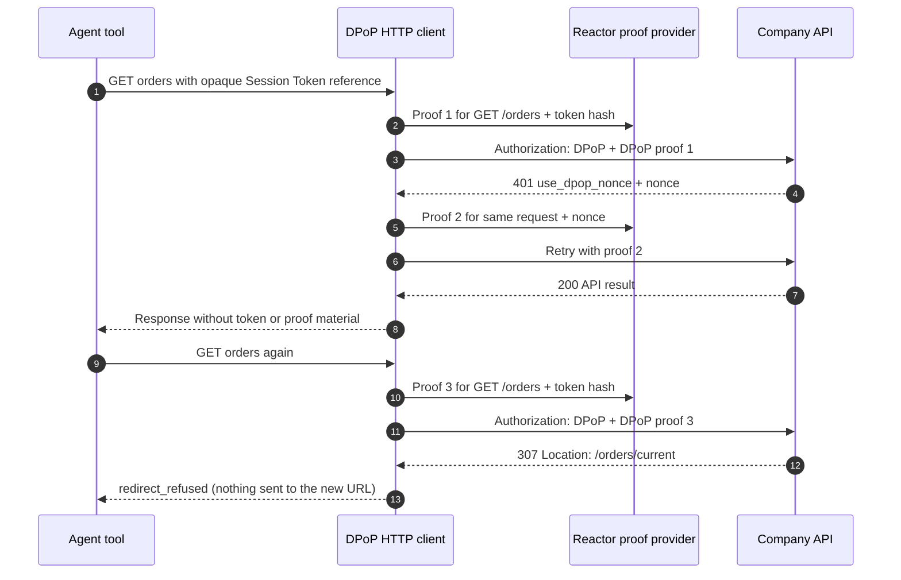

import Deck from '@theme/Deck';
import deck from '@site/decks/examples/dpop-transport.deck.json';

# DPoP-aware transport

<Deck spec={deck} />

Creating a valid proof is only half of DPoP safety. The HTTP transport must
create a new proof for the exact method and URL of every attempt—including a
nonce retry—must refuse a redirect rather than resend the token and a proof to
another URL, and must never let caller-controlled headers override the Session
Token or proof.

## Enforced boundaries

- Only HTTPS resource URLs without embedded credentials are accepted.
- `Authorization` and `DPoP` are host-owned; callers cannot supply or replace
  them.
- Every attempt receives a fresh proof bound to its method, normalized target,
  and Session Token hash.
- A `use_dpop_nonce` challenge is retried once with the company's nonce.
- A redirect is refused (`redirect_refused`): under draft 0.2 §3 no token,
  proof, assertion or body goes to the URL a protocol endpoint redirects to.
  The underlying HTTP client never follows redirects.
- Request bodies are replayable values rather than unbounded streams.

Python exposes `DpopHttpClient`; TypeScript exposes `DpopFetchClient`. Both
resolve proof generation through Reactor and keep Session Tokens, proofs,
nonces, and pairwise identity outside model-visible inputs and results.

:::note MCP remains a separate milestone

MCP uses a resource-bound Bearer Session Token rather than DPoP. Issuing that
token safely depends on the Account Token exchange lifecycle, so the generic
DPoP transport does not accept Bearer tokens or silently downgrade. The plan
keeps MCP acquisition and enforcement open until that lifecycle exists.

:::

Run the [Pydantic AI example](https://github.com/datalayer/personal-agent-protocol/tree/main/examples/pydantic-ai/dpop-transport)
or the [Agent Runtimes example](https://github.com/datalayer/agent-runtimes/tree/main/examples/personal-agent-protocol/dpop-transport).
See upstream [Using Session Tokens](https://personalagentprotocol.org/docs/0.2/spec#sending-tokens).
