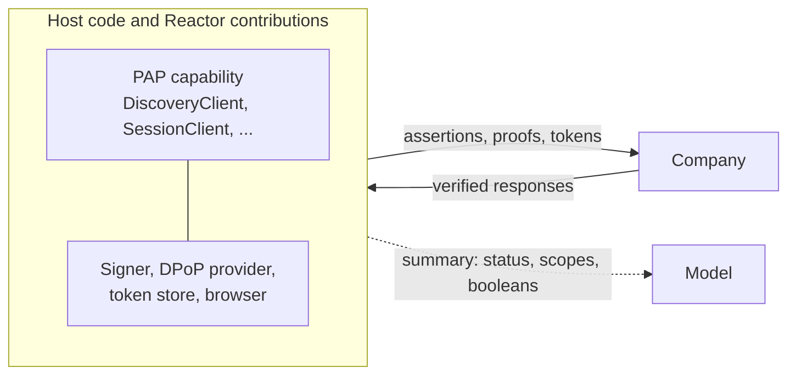

import Deck from '@theme/Deck';
import deck from '@site/decks/examples/index.deck.json';

# Example flows

<Deck spec={deck} />

These pages explain the protocol behavior demonstrated by the runnable Python
and Agent Runtimes examples. Each flow shows where data travels, which Reactor
capability owns sensitive work, and what may safely cross into model context.

| Flow                                                   | What it teaches                                               | Start with                 |
| ------------------------------------------------------ | ------------------------------------------------------------- | -------------------------- |
| [Company discovery](./company-discovery)               | Resolve and validate public PAP capabilities                  | A company domain           |
| [Agent identity](./agent-identity)                     | Verify personal-agent metadata and signing policy             | An `agent.json` URL        |
| [Session assertion](./session-assertion)               | Bind a short-lived request to a pairwise user                 | Verified metadata          |
| [Direct Sign-In boundary](./direct-sign-in-boundary)   | Keep OAuth state and PKCE outside the model                   | A signed-out Session       |
| [DPoP proof](./dpop-proof)                             | Bind one proof to one HTTP request                            | A protected key            |
| [DPoP transport](./dpop-transport)                     | Retry and redirect without replaying proofs or leaking tokens | A Session Token reference  |
| [Conversation messages](./conversation-messages)       | Create and retry idempotent messages safely                   | A conversation endpoint    |
| [Conversation events](./conversation-events)           | Long poll, drain, recover, and de-duplicate ordered events    | A conversation and cursor  |
| [Session lifecycle](./session-lifecycle)               | Start, retry, and renew a signed-out Session                  | An authorization server    |
| [Direct Sign-In lifecycle](./direct-sign-in-lifecycle) | Upgrade the same Session after user consent                   | A browser callback         |
| [Browser Session](./browser-session)                   | Join a controlled browser to the same Session                 | A signed browser assertion |
| [Account Tokens](./account-tokens) | Refresh, rotate, narrow, expire, and revoke without exposing the token | A signed-in Session |
| [Mediated Sign-In](./mediated-sign-in) | Relay protected input to one endpoint, then a one-time code | Declared mediated fields |
| [Conversation streaming](./conversation-streaming) | Stream over SSE, reconnect from `Last-Event-ID`, never act on deltas | An open conversation |
| [Conversation control](./conversation-control) | Sign in mid-conversation, go direct, hand off, and close | An `authorization` event |
| [Operations](./operations) | Confirm the exact revision, recover lost answers, use standing permissions | A proposed operation |
| [A user with a company](./user-with-a-company) | The whole journey with Manzanita, both sides from the SDK | A user's request |
| [Two companies](./two-companies) | Ledgerly acts for Ada at Northwind, by composition | Two PAP relationships |

Some features are shown by a runnable Pydantic AI example alone, with the
guide that explains them:

| Example | What it teaches | Guide |
| --- | --- | --- |
| [Company APIs](https://github.com/datalayer/personal-agent-protocol/tree/main/examples/pydantic-ai/company-apis) | Read and propose through a company's OpenAPI API (DPoP) and its MCP server (a Bearer for its URL alone) | [APIs coverage](/protocol/coverage/apis/) |
| [Company service](https://github.com/datalayer/personal-agent-protocol/tree/main/examples/pydantic-ai/company-service) | Build a company with `personal_agent_protocol.company` and use it end to end | [Integrate a company](/guides/company/) |
| [Sign-in display](https://github.com/datalayer/personal-agent-protocol/tree/main/examples/pydantic-ai/sign-in-display) | What a page gets of a `PapSignIn` display, and what a model is told | [Device Sign-In](/guides/device-sign-in/) |
| [Telemetry](https://github.com/datalayer/personal-agent-protocol/tree/main/examples/pydantic-ai/telemetry) | One allowlisted event per protocol stage | [Telemetry](/guides/telemetry/) |

The examples use deterministic or local transports where needed, so they can
teach the boundary without real credentials. The newer flows run against the
reference company in `personal_agent_protocol.demo`: real keys and real HTTP
over ASGI in one process, with no network. The two journeys at the end of the
table combine several features; each other page showcases one. Production hosts replace those
fixtures through Reactor contributions for egress, state, browsers, signing,
DPoP, key custody, and token storage.

## Two implementations, one boundary

The PAP repository contains plain Pydantic AI examples. Agent Runtimes contains
matching Loop applications and interactive Reactor views, one per flow, at
[`examples/personal-agent-protocol`](https://github.com/datalayer/agent-runtimes/tree/main/examples/personal-agent-protocol).
The protocol and secret-handling rules are the same in both.



### What reaches the model

Agent Runtimes depends on PAP in both Python and TypeScript. Its
`PapPersonalAgentCapability` uses `DiscoveryClient` and `AgentIdentityClient`
(and their TypeScript counterparts) to return aligned public summaries. For
company discovery the tool validates the document and supported protocol
version, follows verified OAuth metadata, and binds the issuer to the requested
company domain. Its result contains only:

- the verified organization and domain;
- the PAP version and issuer;
- advertised sign-in methods and interfaces; and
- extension names.

Raw response bodies, authorization URLs, callback parameters, assertions,
DPoP proofs, Session Tokens, and Account Tokens never enter model context.

### What the Loop applications show

- **`dpop-proof`** creates and verifies a real ES256 proof in host code and
  demonstrates one-use replay rejection. Its Reactor gallery view creates fresh
  device-side proofs with non-exportable Web Crypto keys but keeps only boolean
  policy evidence in React state. Server-side signature and replay verification
  stays behind PAP's `./server` entry and is never bundled into the browser view.
- **`session-lifecycle`** drives the real `SessionClient` against a
  deterministic local company. Nonce retry creates fresh assertions and proofs,
  and renewal is bound to the existing Session ID. Only status, scopes, and
  boolean evidence reach the agent or React state.
- **`direct-sign-in-lifecycle`** drives the real `DirectSignInClient` through
  both sides of the browser pause: atomic state consumption, exact callback
  validation, a proof-bound nonce retry, partial consent, and continuation of
  the original Session. Browser and credential material stays with Reactor
  contributions and the host transport.
- **PAP Guided Journey**, a separate gallery example, advances the user,
  company, and wire views together across discovery, a signed-out conversation,
  Direct Sign-In, the company's offer, and an exact user-authorized result. The
  TypeScript SDK validates its fixtures at runtime, and the inspector shows
  host-only placeholders for every generated credential.

### Run an Agent Runtimes example

From the Agent Runtimes repository root:

```bash
python -m pip install -e .
loop apps run examples/personal-agent-protocol/company-discovery/app.py
```

To validate the application definitions without starting an agent runtime:

```bash
python scripts/validate_pap_examples.py
```

Ask the company-discovery application to inspect a domain that publishes
`/.well-known/poppy.json`. The SDK applies HTTPS, public-network,
response-size, redirect, schema, version, domain, and issuer checks. Production
services must also pin the approved DNS result to the connection or route
requests through an enforcing egress proxy.

### In Datalayer Studio

The metadata examples perform discovery in process to keep the integration
readable. In Datalayer Studio, the agent tool calls the same typed Agent
Runtimes capability, backed by a metadata gateway with opaque tenant and
application context. That gateway owns DNS pinning, egress policy, caching,
rate limits, observability, and audit, and returns the same credential-free
summary.

Direct Sign-In is a separate authorization-gateway workflow. Studio starts it
through a trusted Preview browser handoff, keeps PKCE and one-use state in host
storage, and returns only status or an opaque connection reference to the
application. Browser callbacks, proofs, credentials, and tokens are never agent
tool arguments or results.
