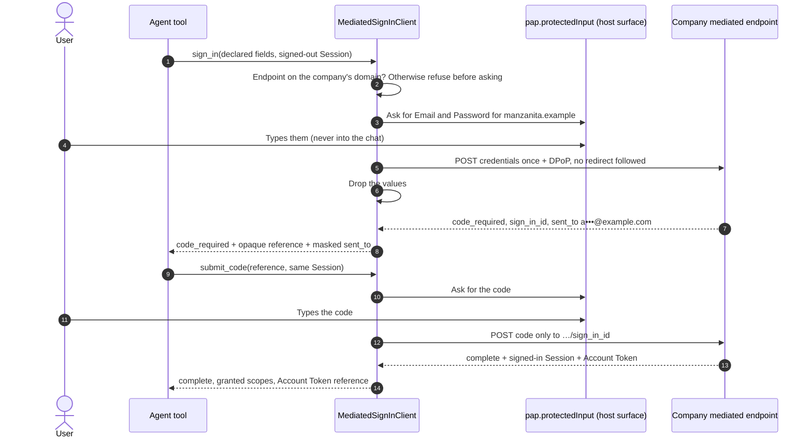

import Deck from '@theme/Deck';
import deck from '@site/decks/examples/mediated-sign-in.deck.json';

# Mediated Sign-In

<Deck spec={deck} />

Some companies can't offer Direct or Device Sign-In yet. They declare the fields
they need (`auth.mediated.fields`) and an endpoint on their own domain, and
the personal agent relays what the user types. It is the one sign-in mode
where a password passes through the agent's host, so the SDK narrows what the
host can do with it. The paired examples run the real `MediatedSignInClient`
against Manzanita Outfitters, which asks for an email, a password, and then a
one-time code. Mediated Sign-In is transitional, like OAuth's password grant:
a company offers it only until it can add Direct or Device Sign-In, and the
protocol plans to remove it at a date set with version 1.0.

The walkthrough also shows the refusals:

- An endpoint off the company's domain is `unsafe_mediated_endpoint`, raised
  before the user is asked anything.
- The protected input must answer exactly the declared fields, none empty.
- Only the Session that started a sign-in can finish it: another Session Key
  is another Session (`session_mismatch`), and the pending state is kept for
  the right one.
- A wrong code is `code_required` again with the same reference; the company
  ends the sign-in with `failed` after its attempt limit.

The model sees field labels, which fields are secret, the company's domain,
the masked destination of the code, statuses, and granted scopes. The
credentials and the code exist only in the host's protected input and in the
one request body; the Session Token and Account Token stay in Reactor stores.

TypeScript: `new MediatedSignInClient({ reactor, fetch })` with `signIn()` and
`submitCode()`, the trusted surface contributed at `ProtectedInputs`.

- Run the [Pydantic AI example](https://github.com/datalayer/personal-agent-protocol/tree/main/examples/pydantic-ai/mediated-sign-in).
- Run the [Agent Runtimes example](https://github.com/datalayer/agent-runtimes/tree/main/examples/personal-agent-protocol/mediated-sign-in).
- Read the [Mediated Sign-In guide](/guides/mediated-sign-in/).
