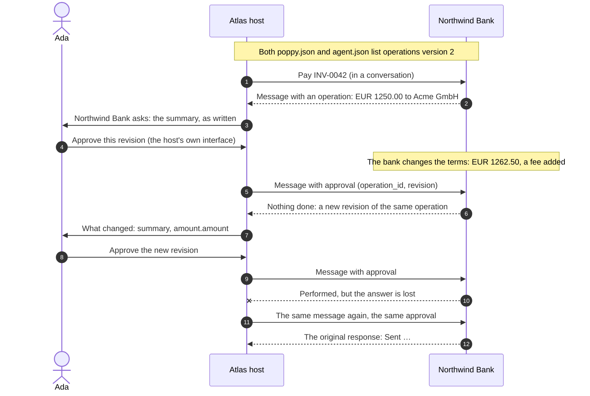

import Deck from '@theme/Deck';
import deck from '@site/decks/examples/operations.deck.json';

# Operations

<Deck spec={deck} />

An operation is an action a company performs only once the user approves its exact
terms: a payment, an exchange, a cancellation. The Operations extension (version 2)
makes the approval exact, and the action happen at most once. The paired examples
get Ada's approval of Northwind Bank's payments.

The walkthrough:

1. **Negotiation.** `operations_negotiated()` is true only when the company and
   the agent both list `operations` version 2. Without it, a company handles
   approval itself or answers with `extension_required`.
2. **The user decides.** `ask_user()` goes through the host's own approval
   surface, naming the company and showing its summary, and every operation is
   asked about. A chat message never approves anything.
3. **New terms.** An approval of a revision the company can't accept performs
   nothing, and the company returns a new revision, never the one named.
   `ask_user(replaces=...)` shows what changed before asking again.
4. **At most once.** `send()` keeps the same approval after a failure or a
   timeout. The company performs the action once, and a repeat gets the original
   response; while it is being performed, `503` and `Retry-After`.

The model sees revisions, changed term paths, error codes, and what the company
says it came to, as written. Tokens stay host-only, and the decision to approve
stays with the user in the host's own interface.

- Run the [Pydantic AI example](https://github.com/datalayer/personal-agent-protocol/tree/main/examples/pydantic-ai/operations).
- Run the [Agent Runtimes example](https://github.com/datalayer/agent-runtimes/tree/main/examples/personal-agent-protocol/operations).
- Read the [Operations guide](/guides/operations/).
