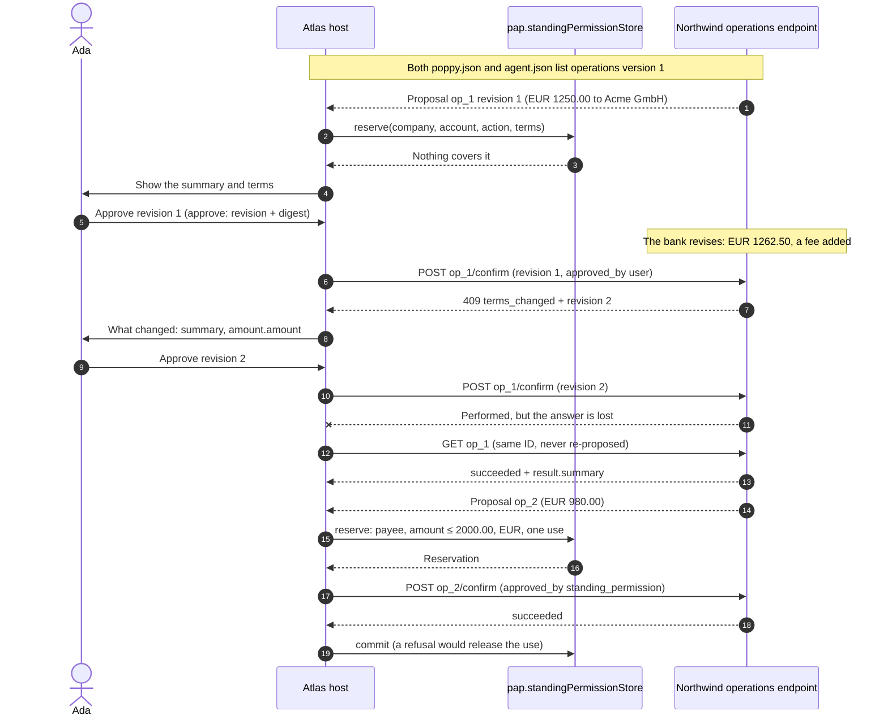

import Deck from '@theme/Deck';
import deck from '@site/decks/examples/operations.deck.json';

# Operations

<Deck spec={deck} />

An operation is something a company proposes and performs only once it is
confirmed: a payment, an exchange, a cancellation. The Operations extension
(version 1) makes the approval exact and durable. The paired examples confirm
Northwind Bank's proposed payments; Northwind marks payments as not requiring
the user's own approval, so a standing permission may confirm them too.

The walkthrough:

1. **Negotiation.** `operations_endpoint()` returns the endpoint only when the
   company and the agent both list `operations` version 1. A company answers
   an agent that does not with `extension_required`.
2. **Exact approval.** `approve(operation)` records the revision and a digest
   of its summary and terms. A confirmation for any other revision is refused
   locally (`approval_mismatch`); a chat message never confirms anything.
3. **Changed terms.** `terms_changed` returns the new revision and the changed
   term paths, to show the user before asking again.
4. **Recovery.** If a confirm's answer is lost, the SDK reads the same
   operation back. It is never re-proposed or assumed failed; a retried
   confirm returns the same record, and the company performs it once.
5. **Standing permissions.** A permission names one company, account, and
   action, with limits on term paths (a maximum or allowed values), an expiry,
   and optional uses. The Reactor `pap.standingPermissionStore` reserves a use
   only when every limit covers the revision; the use is committed when the
   company confirms and released when it refuses. A revision that requires the
   user's approval is never confirmed this way.
6. **Cancel.** A proposal becomes `cancelled`, and the company's
   `result.summary` says nothing was changed.

The model sees states, revisions, changed term paths, error codes, and the
company's `result.summary` as written. Tokens and proofs stay host-only, and
the decision to approve stays with the user in the host's own interface.

TypeScript: `OperationsClient`, `operationsEndpoint()`, and `approve()`
(asynchronous there, since the digest uses Web Crypto), with standing
permissions contributed at `StandingPermissionStores`.

- Run the [Pydantic AI example](https://github.com/datalayer/personal-agent-protocol/tree/main/examples/pydantic-ai/operations).
- Run the [Agent Runtimes example](https://github.com/datalayer/agent-runtimes/tree/main/examples/personal-agent-protocol/operations).
- Read the [Operations guide](/guides/operations/).
