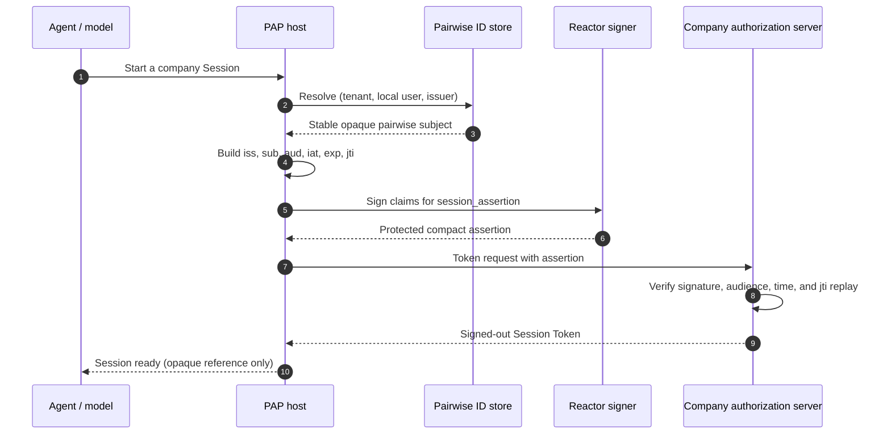

import Deck from '@theme/Deck';
import deck from '@site/decks/examples/session-assertion.deck.json';

# Session assertion

<Deck spec={deck} />

A Session assertion lets a personal agent ask a company for a signed-out
Session without impersonating the human. It identifies the agent in `iss`,
uses a pairwise subject for this company in `sub` (the User ID), names the
company's `auth.issuer` as its only audience, and expires quickly. The token
request that carries it also carries a DPoP proof by a new Session Key, whose
thumbprint names the Session from then on.

## What the example proves

- The subject is pairwise: two companies cannot correlate a user by comparing
  PAP identifiers.
- `aud` is the company's `auth.issuer`, a single string compared character
  for character: never the token endpoint URL, which
  [draft-ietf-oauth-rfc7523bis](https://datatracker.ietf.org/doc/draft-ietf-oauth-rfc7523bis/)
  §4 would also allow, so an assertion can't be used at another company.
- `iat` and `exp` bound its useful lifetime, while a unique `jti` supports
  replay rejection.
- Signing happens through a Reactor capability; private keys and compact
  assertions never become tool arguments or model output.

The small example stops at safe assertion policy. The
[Session lifecycle example](./session-lifecycle) sends the assertion to the
token endpoint with the JWT bearer grant.

Run the [Pydantic AI example](https://github.com/datalayer/personal-agent-protocol/tree/main/examples/pydantic-ai/session-assertion)
or the [Agent Runtimes example](https://github.com/datalayer/agent-runtimes/tree/main/examples/personal-agent-protocol/session-assertion).
