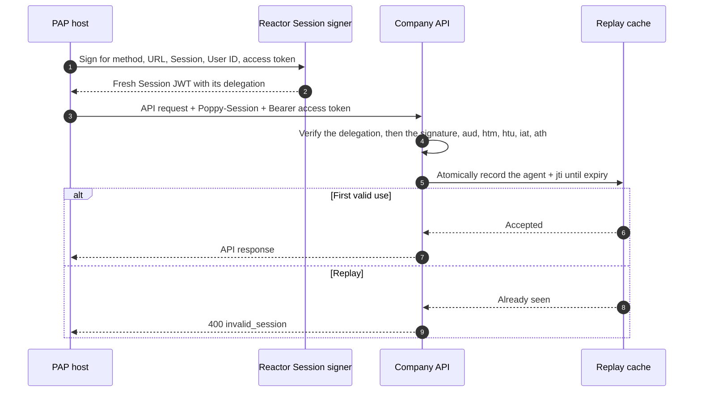

import Deck from '@theme/Deck';
import deck from '@site/decks/examples/dpop-proof.deck.json';

# Session JWT

<Deck spec={deck} />

Every request to a company carries a Session JWT in the `Poppy-Session` header.
It is signed with a delegated key, and a delegation signed by a key from the
agent's `jwks_uri` vouches for that key. The JWT covers the normalized HTTP
method and URL, the company's issuer, the Session and the User ID. When an
access token is present, it also carries the token's hash in `ath`.

## What the example proves

- A new `jti` and Session JWT are required for every attempt, retry, and
  redirect.
- `htm` and normalized `htu` prevent reuse on another request target, and `aud`
  at another company.
- `ath` binds the JWT to the token without embedding that token in the JWT.
- Each User ID at a company has its own delegated key, so a key's thumbprint
  names one User at one Company.
- Replay protection is a server responsibility and must be atomic across the
  company's serving fleet.

The example signs and verifies a real ES256 Session JWT, changes each thing it
covers to show the refusal, then verifies it again to demonstrate rejection.
What a tool may tell a model is that those checks held: its model-visible result
contains policy booleans only. The Session JWT, the delegation, the access token,
the keys, the Session ID, and the User ID stay in the host.

Run the [Pydantic AI example](https://github.com/datalayer/personal-agent-protocol/tree/main/examples/pydantic-ai/session-jwt)
or the [Agent Runtimes example](https://github.com/datalayer/agent-runtimes/tree/main/examples/personal-agent-protocol/dpop-proof).
