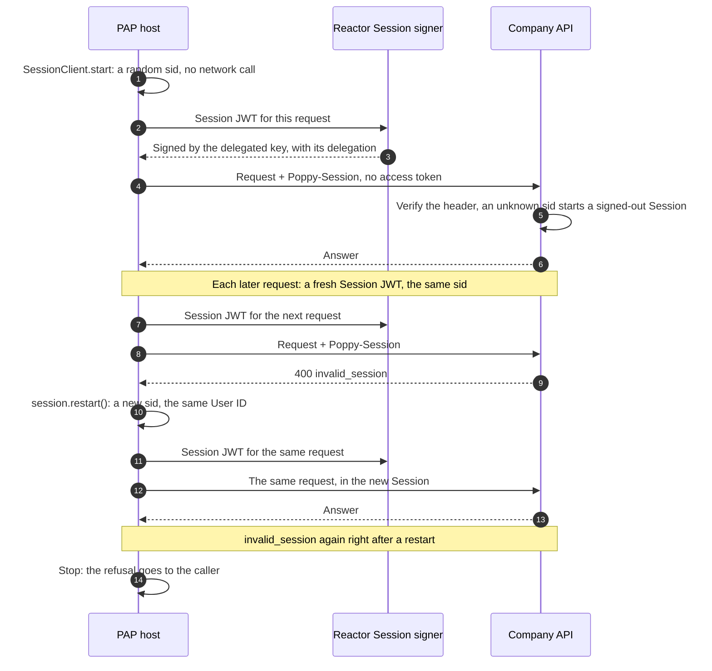

import Deck from '@theme/Deck';
import deck from '@site/decks/examples/session-lifecycle.deck.json';

# Signed-out Session lifecycle

<Deck spec={deck} />

A signed-out Session gives the company a stable, pairwise context before the
user shares account identity. The Session can support public questions and a
conversation that later continues through sign-in. A Session is local:
`SessionClient.start` makes a `PapSession` with a random `sid` and asks the
company nothing. The company meets the Session on its first request, and the
`Poppy-Session` header of every request names it.

## What the example proves

- Starting a Session sends no request. The Session is signed out until a request
  carries an access token.
- Every request carries a new Session JWT, with a new `jti`, for the same `sid`.
- `invalid_session` means the Session failed a check or has ended. The client
  starts a new Session once, with a new `sid`, and sends the request again in it.
- A second `invalid_session` stops there: the refusal goes to the caller.
- The User ID and the delegated key stay the same across a restart.
- Session IDs, pairwise subjects, Session JWTs, delegations, and keys stay inside
  host-owned code and protected storage.
- The model sees only lifecycle status and safe invariants.

To end a Session without signing out, the agent stops using its `sid`. Its refresh
tokens are unaffected.

The deterministic company transport answers `invalid_session` on chosen requests,
so the restart path is always exercised. Production code uses the same
`SessionClient` and `SessionHttpClient` with real HTTPS and managed Reactor
contributions.

Run the [Pydantic AI example](https://github.com/datalayer/personal-agent-protocol/tree/main/examples/pydantic-ai/session-lifecycle)
or the [Agent Runtimes example](https://github.com/datalayer/agent-runtimes/tree/main/examples/personal-agent-protocol/session-lifecycle).
Continue with the [complete Direct Sign-In lifecycle](./direct-sign-in-lifecycle).
