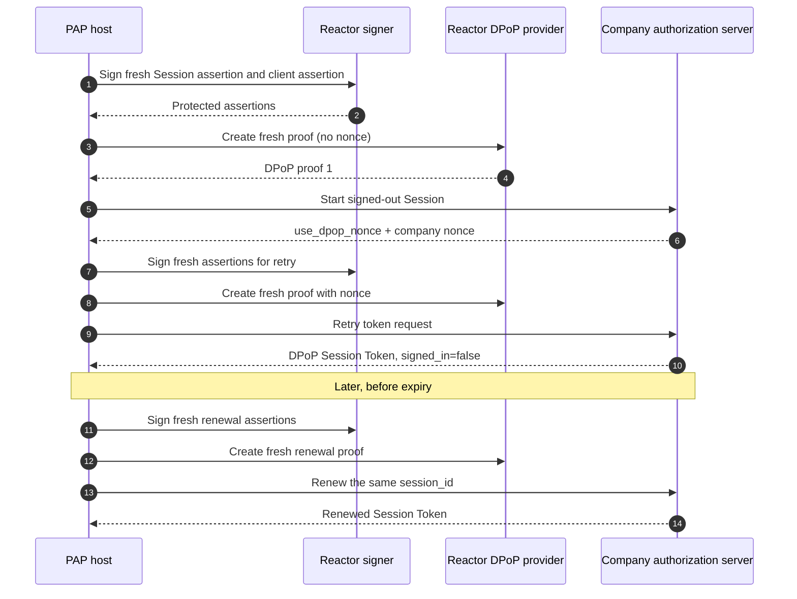

import Deck from '@theme/Deck';
import deck from '@site/decks/examples/session-lifecycle.deck.json';

# Signed-out Session lifecycle

<Deck spec={deck} />

A signed-out Session gives the company a stable, pairwise context before the
user shares account identity. The Session can support public questions and a
conversation that later continues through sign-in.

## What the example proves

- The initial Session is explicitly signed out.
- A DPoP nonce retry produces fresh assertions and a fresh proof.
- Renewal names the existing opaque Session ID instead of creating unrelated
  conversational state.
- Tokens, pairwise subjects, Session IDs, assertions, proofs, and nonces stay
  inside host-owned code and protected storage.
- The model sees only lifecycle status, scopes, and safe invariants.

The deterministic company transport returns one nonce challenge so the retry
path is always exercised. Production code uses the same `SessionClient` with
real HTTPS and managed Reactor contributions.

Run the [Pydantic AI example](https://github.com/datalayer/personal-agent-protocol/tree/main/examples/pydantic-ai/session-lifecycle)
or the [Agent Runtimes example](https://github.com/datalayer/agent-runtimes/tree/main/examples/personal-agent-protocol/session-lifecycle).
Continue with the [complete Direct Sign-In lifecycle](./direct-sign-in-lifecycle).
