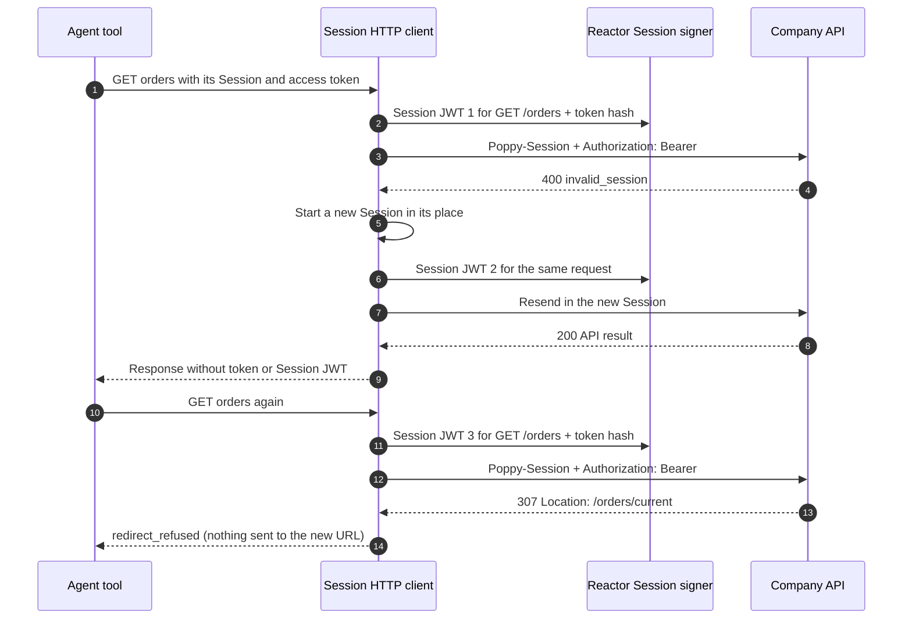

import Deck from '@theme/Deck';
import deck from '@site/decks/examples/session-transport.deck.json';

# Session transport

<Deck spec={deck} />

Signing a valid Session JWT is only half of the job. The HTTP transport must ask
for a new one for the exact method and URL of every attempt, must refuse a
redirect rather than resend the token to another URL, and must never let
caller-controlled headers override the Session header or the access token.

## Enforced boundaries

- Only HTTPS resource URLs without embedded credentials are accepted.
- `Authorization`, `Poppy-Session` and the signature headers are host-owned; callers cannot supply or
  replace them.
- Every attempt receives a fresh Session JWT bound to its method, normalized
  target, and access token hash.
- An `invalid_session` answer starts a new Session once, and the request is sent
  again in it; a second one is returned to the caller.
- A redirect is refused (`redirect_refused`): under draft 0.3 §3 no token,
  Session JWT, assertion or body goes to the URL a protocol endpoint redirects to.
  The underlying HTTP client never follows redirects.
- Request bodies are replayable values rather than unbounded streams.

Python exposes `SessionHttpClient`. It resolves signing through Reactor and keeps
access tokens, Session JWTs, and Session IDs outside model-visible inputs and
results.

Run the [Pydantic AI example](https://github.com/datalayer/personal-agent-protocol/tree/main/examples/pydantic-ai/session-transport)
or the [Agent Runtimes example](https://github.com/datalayer/agent-runtimes/tree/main/examples/personal-agent-protocol/session-transport).
