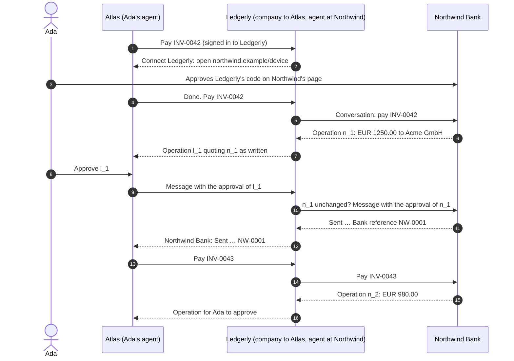

import Deck from '@theme/Deck';
import deck from '@site/decks/examples/two-companies.deck.json';

# Two companies

<Deck spec={deck} />

:::caution Composition, not a draft 0.3 feature

PAP draft 0.3 defines no company-to-company protocol. This example composes
two ordinary PAP relationships for the same user. Ledgerly is a **company** to
Ada's personal agent, Atlas, and a **personal agent** at Northwind Bank for
the same Ada, with its own `client_id` and keys on its own domain.

:::

Ledgerly, an accounting firm, pays Ada's supplier invoices from her Northwind
account. Every approval is an Operation, never a chat message, and Ada is asked
about every payment.

What each party enforces:

- **Northwind** sees a personal agent called Ledgerly, signed in by Ada on
  Northwind's own page, sending approvals of its operations. Its records keep
  which revision was approved, and when.
- **Ledgerly** approves at Northwind only the exact revision Ada approved: its
  executor checks Northwind's revision and terms are unchanged before sending the
  approval, and relays what Northwind says it came to as written.
- **Atlas** treats Ledgerly like any company: it shows each operation's summary
  through the host's own surface, and sends only what Ada approved.

The model sees summaries as the companies wrote them, and that the composition involves no company-to-company protocol.
It never sees a token, code, or proof of any of the three parties.

The same world runs in `personal_agent_protocol/__tests__/test_two_companies.py`.

- Run the [Pydantic AI example](https://github.com/datalayer/personal-agent-protocol/tree/main/examples/pydantic-ai/two-companies).
- Run the [Agent Runtimes example](https://github.com/datalayer/agent-runtimes/tree/main/examples/personal-agent-protocol/two-companies).
- Read the [Operations guide](/guides/operations/) and the [company guide](/guides/company/).
