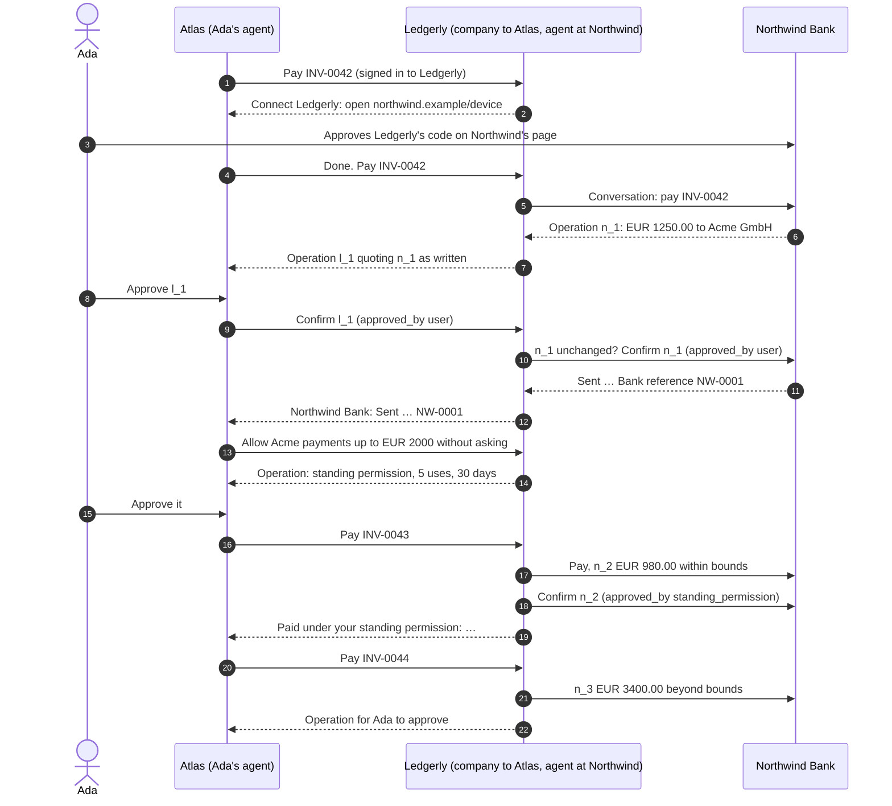

# Two companies

:::caution Composition, not a draft 0.1 feature

PAP draft 0.1 defines no company-to-company protocol. This example composes
two ordinary PAP relationships for the same user. Ledgerly is a **company** to
Ada's personal agent, Atlas, and a **personal agent** at Northwind Bank for
the same Ada, with its own `client_id` and keys on its own domain.

:::

Ledgerly, an accounting firm, pays Ada's supplier invoices from her Northwind
account. Every approval is an Operation, never a chat message, and a standing
permission is itself an Operation Ada approves.

What each party enforces:

- **Northwind** sees a personal agent called Ledgerly, signed in by Ada on
  Northwind's own page, confirming its proposals. Its records say who approved
  each payment: `user` for the first, `standing_permission` for the second.
- **Ledgerly** confirms at Northwind only the exact revision Ada approved: its
  executor checks Northwind's revision and terms are unchanged before
  confirming, and relays Northwind's `result.summary` as written. Within the
  standing permission's term-by-term bounds it confirms itself and tells Ada
  what was done; beyond them, it proposes a new operation for her.
- **Atlas** treats Ledgerly like any company: it shows each operation's
  summary and terms, and confirms only what Ada approved.

The model sees summaries as the companies wrote them, who approved each
payment, and that the composition involves no company-to-company protocol.
It never sees a token, code, or proof of any of the three parties.

The same world runs in `personal_agent_protocol/__tests__/test_two_companies.py`.

- Run the [Pydantic AI example](https://github.com/datalayer/personal-agent-protocol/tree/main/examples/pydantic-ai/two-companies).
- Run the [Agent Runtimes example](https://github.com/datalayer/agent-runtimes/tree/main/examples/personal-agent-protocol/two-companies).
- Read the [Operations guide](/guides/operations/) and the [company guide](/guides/company/).
