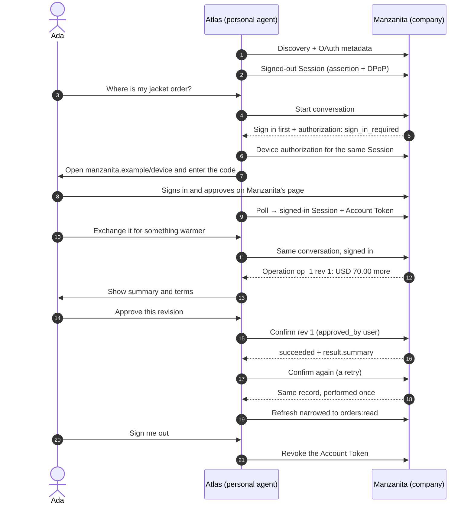

import Deck from '@theme/Deck';
import deck from '@site/decks/examples/user-with-a-company.deck.json';

# A user with a company

<Deck spec={deck} />

The whole journey of the upstream home page's example: Ada's jacket is not
warm enough, and she asks her personal agent, Atlas, to exchange it at
Manzanita Outfitters. Both sides come from this SDK. Manzanita is the
[reference company](/guides/company/) assembled from Reactor contributions,
Atlas is a personal agent with a real ES256 identity, and they talk real HTTP
over ASGI in one process, with no network and no model in the protocol path.

Each step is one feature, documented on its own page:
[company discovery](./company-discovery), [session lifecycle](./session-lifecycle),
[conversation control](./conversation-control) for the `authorization`
event, [Device Sign-In](./device-sign-in), [Operations](./operations), and
[Account Tokens](./account-tokens).

The model sees the steps in plain words: what the company asked, where Ada
signed in, what was proposed, what she approved, and what Manzanita did, in
its own words. It never sees the device code, a token, an assertion, or a
proof. Ada approves in the host's interface; the model can explain the
proposal but cannot approve it.

The same world runs in `personal_agent_protocol/__tests__/test_company_end_to_end.py`,
which also covers Mediated Sign-In with a one-time code, streaming, and a
stranger refused with `conversation_not_found`.

- Run the [Pydantic AI example](https://github.com/datalayer/personal-agent-protocol/tree/main/examples/pydantic-ai/user-with-a-company).
- Run the [Agent Runtimes example](https://github.com/datalayer/agent-runtimes/tree/main/examples/personal-agent-protocol/user-with-a-company).
- Read the [company guide](/guides/company/).
