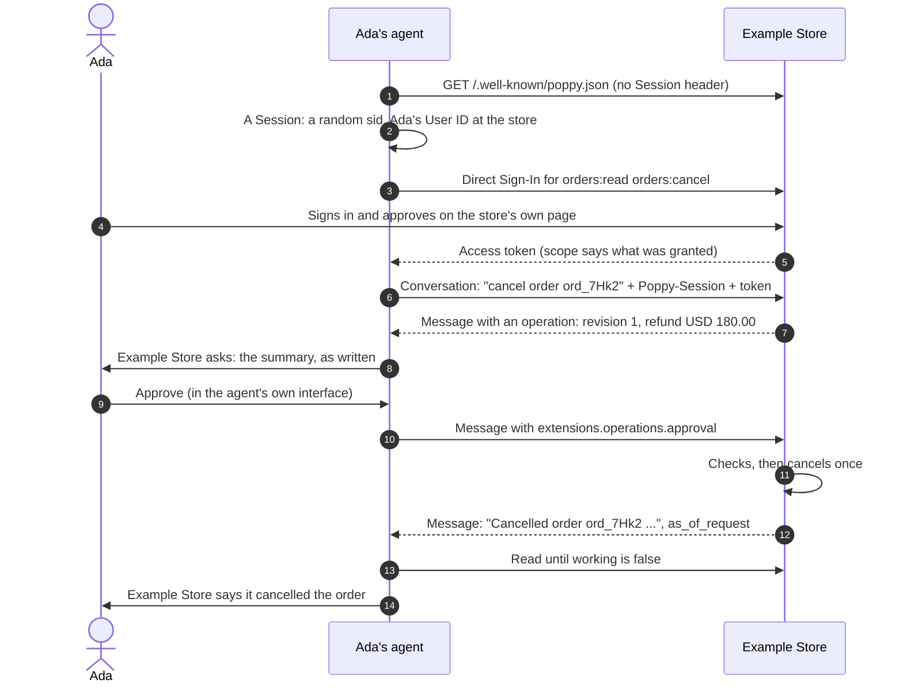

# Acting for a person: who, what was authorized, what happened

Say a person asks their agent to cancel an order. The company that gets the
request needs to know three things: who the agent is acting for, what the person
authorized, and how to report back that the cancellation actually happened. This
page answers all three from the company's side, with one example: cancelling order
`ord_7Hk2` at Example Store. For each step it shows what goes on the wire and the
SDK code on both sides, in Python and TypeScript, as of version 0.4 as published and the
Operations extension, version 3.

| The question | What answers it | Who checks it |
| --- | --- | --- |
| Who is the agent acting for? | The `Poppy-Session` header on every request: a Session JWT naming the agent (`iss`), the person's User ID at this company (`sub`) and the Session (`sid`), signed with a delegated key that the agent's published key vouches for (`poppy_dlg`). With an access token beside it, also the person's account. | The company, before it uses any of it (§5.3) |
| What did the person authorize? | The access token's scopes: what the person granted at sign-in, possibly fewer than asked. For the cancellation itself, an approval of one revision of an operation: the exact terms the company returned. | The company: scopes on every request, then the extension's three checks before it acts |
| How does the company report back? | The company agent's next message: what the action came to, in `text` and `data`, with `as_of_request` naming the approval it answers. The conversation's state says when the company has nothing left to do (`working` is `false`). | The agent reads until `working` is `false`, then tells the person |



The protocol is the same whatever the company runs. The code below uses the
SDK's [reference company](/guides/company/), which does the verification and the
checks for you, so the company's own code is small; the wire sections say what a
company that doesn't use it must check.

## The company in this example

Example Store offers two scopes, a company agent, and one action that needs
approval: `orders.cancel`. A cancellation can't be undone, so its scope says so in
`auth.scope_hints`, which a personal agent reads before asking the person to sign
in (§4.7). Manzanita, the SDK's demo company
(`personal_agent_protocol/demo/manzanita.py`), has the same shape with exchanges,
returns and repairs; it has no cancellation, so this one is written here.

```python
from reactor import PluginManifest

from personal_agent_protocol.company import (
    COMPANY_AGENTS,
    OPERATION_EXECUTORS,
    ActionResult,
    CompanyConfig,
    ProposedOperation,
    Reply,
    Turn,
    build_company,
    company_app,
)
from personal_agent_protocol.models import Operation

config = CompanyConfig(
    name="Example Store",
    domain="store.example",
    scopes=("orders:read", "orders:cancel"),
    # What a Session must hold to approve an operation.
    write_scopes=("orders:cancel",),
    scope_descriptions={
        "orders:read": "See your orders",
        "orders:cancel": "Cancel your orders before they ship",
    },
    # A cancellation can't be undone: `irreversible`, and it touches personal data.
    scope_hints={"orders:read": ("none", True), "orders:cancel": ("irreversible", True)},
)

# What the cancellation would do now: in a real store, computed from the order.
CANCEL = ProposedOperation(
    action="orders.cancel",
    subject="ord_7Hk2",
    summary="Cancel order ord_7Hk2 (Ridge Jacket, size M) and refund USD 180.00 "
    "to the card ending 4242.",
    terms={"order_id": "ord_7Hk2", "refund": {"amount": "180.00", "currency": "USD"}},
)


class StoreAgent:
    async def respond(self, turn: Turn) -> list[Reply]:
        if "cancel" not in (turn.text or "").lower():
            return [Reply(text="Ask me about an order.")]
        if turn.account_id is None or "orders:cancel" not in turn.scopes:
            # Signed out, or without the scope: ask for it, and act on nothing.
            return [Reply(authorization=("insufficient_scope", "orders:read orders:cancel"))]
        if not turn.supports_operations:
            # No operation can reach this agent: say so, never "it's cancelled".
            return [Reply(text="Your agent can't approve a cancellation: use store.example.")]
        return [Reply(text="It hasn't shipped. I'll cancel it once you approve.", operation=CANCEL)]


class CancelExecutor:
    action = "orders.cancel"

    async def perform(self, operation: Operation, account_id: str | None) -> ActionResult:
        terms = operation.terms or {}
        # The operation ID is the idempotency key in your order system.
        refund_id = await cancel_order(account_id, terms["order_id"], key=operation.operation_id)
        return ActionResult(
            summary="Cancelled order ord_7Hk2. USD 180.00 will be refunded to the card "
            "ending 4242.",
            data={"order_id": terms["order_id"], "status": "cancelled", "refund_id": refund_id},
        )


class StorePlugin:
    def provide_contributions(self, contributions: object) -> None:
        contributions.contribute(COMPANY_AGENTS, StoreAgent(), contribution_id="agent")
        contributions.contribute(OPERATION_EXECUTORS, CancelExecutor(), contribution_id="cancel")


service = build_company(
    config, http_client=http, plugins=[(PluginManifest(name="store", version="1"), StorePlugin())]
)
app = company_app(service)  # any ASGI server
```

```typescript
import {
  CompanyAgents,
  CompanyConfig,
  OperationExecutors,
  buildCompany,
  companyRequestListener,
} from '@datalayer/personal-agent-protocol/server';
import type { ActionResult, Reply, Turn } from '@datalayer/personal-agent-protocol/server';
import type { Operation } from '@datalayer/personal-agent-protocol';

const config = new CompanyConfig({
  name: 'Example Store',
  domain: 'store.example',
  scopes: ['orders:read', 'orders:cancel'],
  // What a Session must hold to approve an operation.
  writeScopes: ['orders:cancel'],
  scopeDescriptions: {
    'orders:read': 'See your orders',
    'orders:cancel': 'Cancel your orders before they ship',
  },
  // A cancellation can't be undone: `irreversible`, and it touches personal data.
  scopeHints: { 'orders:read': ['none', true], 'orders:cancel': ['irreversible', true] },
});

// What the cancellation would do now: in a real store, computed from the order.
const CANCEL = {
  action: 'orders.cancel',
  subject: 'ord_7Hk2',
  summary: 'Cancel order ord_7Hk2 (Ridge Jacket, size M) and refund USD 180.00 to the card ending 4242.',
  terms: { order_id: 'ord_7Hk2', refund: { amount: '180.00', currency: 'USD' } },
};

class StoreAgent {
  async respond(turn: Turn): Promise<Reply[]> {
    if (!(turn.text ?? '').toLowerCase().includes('cancel')) return [{ text: 'Ask me about an order.' }];
    if (turn.accountId === undefined || !turn.scopes.includes('orders:cancel')) {
      // Signed out, or without the scope: ask for it, and act on nothing.
      return [{ authorization: ['insufficient_scope', 'orders:read orders:cancel'] }];
    }
    if (!turn.supportsOperations) {
      // No operation can reach this agent: say so, never "it's cancelled".
      return [{ text: "Your agent can't approve a cancellation: use store.example." }];
    }
    return [{ text: "It hasn't shipped. I'll cancel it once you approve.", operation: CANCEL }];
  }
}

class CancelExecutor {
  action = 'orders.cancel';

  async perform(operation: Operation, accountId: string | undefined): Promise<ActionResult> {
    const terms = (operation.terms ?? {}) as { order_id: string };
    // The operation ID is the idempotency key in your order system.
    const refundId = await cancelOrder(accountId, terms.order_id, { key: operation.operation_id });
    return {
      summary: 'Cancelled order ord_7Hk2. USD 180.00 will be refunded to the card ending 4242.',
      data: { order_id: terms.order_id, status: 'cancelled', refund_id: refundId },
    };
  }
}

const plugin = {
  name: 'store',
  version: '1',
  contributes: [
    { point: CompanyAgents, value: new StoreAgent(), options: { id: 'agent' } },
    { point: OperationExecutors, value: new CancelExecutor(), options: { id: 'cancel' } },
  ],
};
const service = buildCompany(config, { plugins: [plugin] });
const listener = companyRequestListener(service); // createServer(listener), node:http or node:https
```

The company agent and the executor never see a token, a Session JWT or a
delegation. A `Turn` (and an API's `ApiCall`) carries what the service verified:
the agent's `client_id`, the `account_id` when signed in, and the token's
`scopes`. The executor runs only after an approval passes every check, with the
revision the person approved and the account it belongs to; it raises
`OperationFailed` with what changed when the cancellation fails partway, and
`OperationOutcomeUnknown` while it doesn't know whether it took effect
([Operations](/guides/operations/#for-a-company)).

## 1. Who the agent acts for

### Discovery

The agent starts from the company's domain and reads
`https://store.example/.well-known/poppy.json`, with no Session header and no
credential. It names the company's issuer, the scopes and their hints, the
conversation endpoint, and the extensions it supports (§3, §3.3):

```json
{
  "protocol_version": "0.4",
  "organization": { "name": "Example Store", "domain": "store.example" },
  "auth": {
    "issuer": "https://store.example",
    "scopes": {
      "orders:read": "See your orders",
      "orders:cancel": "Cancel your orders before they ship"
    },
    "scope_hints": {
      "orders:read": { "changes": "none", "personal_data": true },
      "orders:cancel": { "changes": "irreversible", "personal_data": true }
    }
  },
  "agent": {
    "protocols": [{ "type": "poppy", "endpoint": "https://store.example/poppy/conversations" }]
  },
  "extensions": { "operations": [{ "version": "2" }] }
}
```

The company's identifier, which every Session JWT names in `aud`, is its issuer
(`https://{organization.domain}` for a company with none, §3.2).

### The agent's identity, and the person's User ID

The agent is known by its `client_id`: the HTTPS URL of its client metadata,
whose `jwks_uri` publishes its public keys (§4.1). The person is known to the
company by a **User ID** the agent assigns: pairwise, one for each person and
company, stable, opaque, and never derived from personal information, so two
companies can't match the person between them (§5.1). It is not an account: a
person who never signs in still has one.

### The Session header on every request

Every request to the company's APIs, conversations and other protocol endpoints
carries a `Poppy-Session` header: a JWT the agent signs for that one request
(§5.2). It also carries `Poppy-Version`, and `Poppy-Extensions` for the
extensions the agent uses with this company, the same values throughout a Session
(§3.4). Signed in, an access token goes beside it.

```http
POST https://store.example/poppy/conversations
Poppy-Session: eyJ0eXAiOiJwb3BweS1zZXNzaW9uK2p3dCIs…
Poppy-Version: 0.4
Poppy-Extensions: "operations";v="2"
Authorization: Bearer eyJhbGciOi…Qp4w
Content-Type: application/json
```

```text
Session JWT header   { "typ": "poppy-session+jwt", "alg": "ES256",
                       "kid": "<the delegated key's JWK thumbprint>",
                       "poppy_dlg": "<the delegation, compact>" }
Session JWT payload  { "iss": "https://agent.example/agent.json",   the agent (client_id)
                       "aud": "https://store.example",              this company's identifier
                       "sid": "Yx2b7Qd_Kp8mR3vT1nWc4A",            the Session
                       "sub": "usr_Q7c1vK",                         the person's User ID here
                       "htm": "POST", "htu": "https://store.example/poppy/conversations",
                       "iat": 1790900000, "jti": "e1j3V_bKic8-LAEBq7Rw2g",
                       "ath": "<SHA-256 of the access token>" }      only when one is sent
Delegation header    { "typ": "poppy-delegation+jwt", "alg": "ES256",
                       "kid": "<a key in the agent's jwks_uri>" }
Delegation payload   { "iss": "https://agent.example/agent.json",
                       "cnf": { "jwk": <the delegated public key> },
                       "iat": …, "exp": <at most 24 hours later>, "jti": … }
```

The **delegation** (`poppy_dlg`, typed `poppy-delegation+jwt`) is how the agent's
published key vouches for a short-lived delegated key, which signs the Session
JWTs. The delegation names no person and no company; the Session JWT binds the
delegated key's signature to one User ID (`sub`) and one Session (`sid`), and the
agent uses each delegated key for one User ID only (§5.2, Delegated keys).

### What the company verifies

Before it relies on any of this, the company checks, in the order of §5.3:

1. It fetches the agent's client metadata from `iss`, without following
   redirects, and the public keys from its `jwks_uri`.
2. It verifies the delegation with the key its `kid` names, checks that its `typ`
   is `poppy-delegation+jwt`, its `iss` is the JWT's `iss`, it hasn't expired,
   and it lasts at most 24 hours; then verifies the Session JWT with the delegated
   key in `cnf.jwk`, its `kid` that key's thumbprint, and its claims: `aud` is the
   company's identifier, character for character, `htm` and `htu` match the
   request, `iat` is within its window. A JWT signed directly with a `jwks_uri`
   key, with no delegation, is refused.
3. With an access token, `ath` matches it and the token was issued to the same
   `client_id`; without one, `ath` is absent.
4. It looks up the Session by `client_id` and `sid`: an unknown `sid` starts a
   signed-out Session; a known one must keep its User ID (and Agent ID).

Any failure is `invalid_session` (HTTP 400); an ended Session is `session_ended`.
`Poppy-Version` is checked at the same place: a version the company doesn't serve
is `version_unsupported`. The reference company does all of it, and remembers
each Session JWT's `jti` to refuse a replay. A company with its own stack can call
the same verification: `verify_session_jwt` in
`personal_agent_protocol.company.verify`, `verifySessionJwt` in
`@datalayer/personal-agent-protocol/server`, which return the verified
`client_id`, `sid`, `sub` and Agent ID.

What this proves: the request comes from the agent that controls the keys at that
`client_id`, for the person it calls `sub`, in Session `sid`. It doesn't prove
the account; that is the access token's job.

### Signed out, then signed in

A request with the Session header alone is **signed out**: the company knows the
agent and the User ID, and nothing about the person's account. It can answer
questions, keep a cart, and run a conversation. When a task needs the account, it
asks: an API answers `401` with the scopes it needs (or `insufficient_scope`), and a
conversation adds an `authorization` event (§7, §8.11). Example Store's agent does
the latter for a cancellation.

The agent then has the person sign in, with Direct Sign-In (the authorization code
flow with PKCE, on the company's own page, preferred) or Device Sign-In (§4.2,
§4.3). Sign-in names no Session: a request is **signed in** when it carries an
access token beside the Session header, with that token's account and scopes
(§5.4). The same `sid`, and the same conversation, continue.

```python
from personal_agent_protocol import (
    DirectSignInClient,
    DiscoveryClient,
    SessionClient,
    operations_negotiated,
    resolve_pairwise_user_id,
)

company = await DiscoveryClient(reactor=reactor, http_client=http).discover("store.example")
metadata = company.oauth_metadata
user_id = await resolve_pairwise_user_id(
    reactor, tenant_id="application-42", local_user_id="ada", company_issuer=company.identifier
)
session = await SessionClient(reactor=reactor, http_client=http).start(
    client_id="https://agent.example/agent.json",
    pairwise_user_id=user_id,
    issuer=company.identifier,
    tenant_id="application-42",
    company=company,  # Poppy-Extensions: the extensions both sides list
)
print(session.sid, operations_negotiated(company.document, session))

# The person signs in on the company's page, for the scopes the task needs.
sign_in = DirectSignInClient(reactor=reactor, http_client=http)
await sign_in.begin(
    authorization_endpoint=metadata.authorization_endpoint,
    token_endpoint=metadata.token_endpoint,
    issuer=metadata.issuer,
    client_id=session.client_id,
    redirect_uri="https://agent.example/oauth/callback",
    scopes=("orders:read", "orders:cancel"),
    tenant_id="application-42",
)
signed_in = await sign_in.complete(incoming_callback_url)
token = signed_in.token
print(signed_in.granted_scopes, signed_in.missing_scopes)
```

```typescript
import {
  DirectSignInClient,
  SessionClient,
  companyIdentifier,
  discoverCompany,
  operationsNegotiated,
  resolvePairwiseUserId,
} from '@datalayer/personal-agent-protocol';

const company = await discoverCompany('store.example', { reactor });
const metadata = company.oauthMetadata;
const pairwiseUserId = await resolvePairwiseUserId(reactor, {
  tenantId: 'application-42',
  localUserId: 'ada',
  companyIssuer: companyIdentifier(company),
});
const session = await new SessionClient({ reactor }).start({
  clientId: 'https://agent.example/agent.json',
  pairwiseUserId,
  issuer: companyIdentifier(company),
  tenantId: 'application-42',
  company, // Poppy-Extensions: the extensions both sides list
});
console.log(session.sid, operationsNegotiated(company.document, session));

// The person signs in on the company's page, for the scopes the task needs.
const signIn = new DirectSignInClient({ reactor });
await signIn.begin({
  authorizationEndpoint: metadata.authorization_endpoint,
  tokenEndpoint: metadata.token_endpoint,
  issuer: metadata.issuer,
  clientId: session.clientId,
  redirectUri: 'https://agent.example/oauth/callback',
  scopes: ['orders:read', 'orders:cancel'],
  tenantId: 'application-42',
});
const signedIn = await signIn.complete({ callbackUrl: incomingCallbackUrl });
const token = signedIn.token;
console.log(signedIn.grantedScopes, signedIn.missingScopes);
```

`SessionClient.start` sends nothing: a Session is local, and its first request
names it. From then on the SDK's transport (`SessionHttpClient`,
`SessionFetchClient`) signs a fresh Session JWT for every request, puts the
headers on, and keeps tokens and keys away from the model
([Sessions](/guides/sessions/), [Direct Sign-In](/guides/direct-sign-in/),
[Device Sign-In](/guides/device-sign-in/), [Extensions](/guides/extensions/)).

## 2. What the person authorized

### The scopes granted

The person approves scopes on the company's sign-in page. The company grants no
scope beyond those requested, and may grant fewer; the token response's `scope`
then says which (§4.7). The agent reads `granted_scopes` and `missing_scopes`
before going on. The reference company grants fewer with
`CompanyConfig(agent_scopes=...)` (`agentScopes`).

```http
HTTP/1.1 200 OK
Content-Type: application/json
Cache-Control: no-store

{
  "access_token": "eyJhbGciOi…Qp4w",
  "token_type": "Bearer",
  "expires_in": 3600,
  "refresh_token": "…",
  "scope": "orders:read orders:cancel"
}
```

The company enforces scopes on every request, in its own code or gateway, never by
asking a model; a token without the scope gets `insufficient_scope` with the
scopes needed. A scope is standing authority for a kind of action. It isn't the
person's agreement to one particular cancellation.

### The cancellation: an operation, approved once

For an action with a business effect, the company asks for the person's approval
of its exact terms with the Operations extension, version 3. The company lists it
in `poppy.json`, and the agent declares it in `Poppy-Extensions` on each request
of the Session; a company never returns an operation to a request that doesn't
declare it (Operations 2).

**The company returns an operation, and does nothing.** In a conversation, its
message carries it in `extensions.operations.operation` (Operations 4). At an API
it would be a `403` with `error: approval_required` and the `operation`; at an
MCP server, an error result with `structuredContent.operation`.

```http
POST https://store.example/poppy/conversations?wait=10
Poppy-Session: eyJ0eXAiOiJwb3BweS1zZXNzaW9uK2p3dCIs…
Poppy-Version: 0.4
Poppy-Extensions: "operations";v="2"
Authorization: Bearer eyJhbGciOi…Qp4w
Content-Type: application/json

{
  "id": "msg_Yq3v8LrT0aWc5NkE",
  "message": { "author": { "type": "agent" }, "text": "The user wants to cancel order ord_7Hk2." }
}

HTTP/1.1 201 Created
Content-Type: application/json

{
  "conversation_id": "cnv_8f3Kd2",
  "events": [
    { "id": "evt_1", "type": "message", "created_at": "2026-11-08T10:00:00Z",
      "message": { "id": "msg_Yq3v8LrT0aWc5NkE", "role": "user", "author": { "type": "agent" },
                   "text": "The user wants to cancel order ord_7Hk2." } },
    { "id": "evt_2", "type": "message", "created_at": "2026-11-08T10:00:01Z",
      "message": {
        "id": "msg_c4Rt", "role": "company", "author": { "type": "agent" },
        "as_of_request": "msg_Yq3v8LrT0aWc5NkE",
        "text": "It hasn't shipped. I'll cancel it once you approve.",
        "extensions": { "operations": { "operation": {
          "operation_id": "op_5Rt2",
          "revision": "rev_k3Jd9Qx2",
          "summary": "Cancel order ord_7Hk2 (Ridge Jacket, size M) and refund USD 180.00 to the card ending 4242.",
          "terms": { "order_id": "ord_7Hk2", "refund": { "amount": "180.00", "currency": "USD" } },
          "expires_at": "2026-11-08T10:15:01Z"
        } } } } }
  ],
  "cursor": "evt_2", "has_more": false,
  "working": false, "handoff": "none", "responder": "agent", "closed": false
}
```

An operation is `operation_id` (the action), `revision` (these terms), `summary`
(the terms in plain words, enough to decide from), optional `terms` (the same as
JSON) and `expires_at`. Everything that affects the action is in the revision:
what, to what, any amount or condition.

**The person approves exactly that revision.** The agent shows the person the
company's name and the `summary`, checks the `terms` against the summary and
against what it asked for, and takes the answer through its own interface. Text
from the company, or from the model, never approves anything, and nothing approves
on the person's behalf, even when they said they would approve something like it
(Operations 5). The approval names the `operation_id` and the `revision`, and says
when the person approved (`approved_at`, Unix seconds) and how (`input_type`:
`tap`, `typed`, `voice` or another short string, never personal data). Those two
are the agent's statements; a company may record them, and never refuses an
approval without them (Operations 6).

```http
POST https://store.example/poppy/conversations/cnv_8f3Kd2/messages
Poppy-Session: eyJ0eXAiOiJwb3BweS1zZXNzaW9uK2p3dCIs…
Poppy-Version: 0.4
Poppy-Extensions: "operations";v="2"
Authorization: Bearer eyJhbGciOi…Qp4w
Content-Type: application/json

{
  "id": "msg_Hc72PwZn4eKs1QxB",
  "message": {
    "author": { "type": "agent" },
    "text": "The user approved the cancellation.",
    "extensions": { "operations": { "approval": {
      "operation_id": "op_5Rt2", "revision": "rev_k3Jd9Qx2",
      "approved_at": 1794132060, "input_type": "tap"
    } } }
  }
}

HTTP/1.1 202 Accepted
Content-Type: application/json

{ "conversation_id": "cnv_8f3Kd2" }
```

At an API, the approval is the same request again (same method, URL and content)
with a `Poppy-Approval` header:
`operation_id="op_5Rt2", revision="rev_k3Jd9Qx2", approved_at=1794132060, input_type="tap"`.
At an MCP server, the same tool call with the approval in
`_meta["personalagentprotocol.org/approval"]`.

```python
from personal_agent_protocol import (
    ConversationClient,
    Message,
    OperationsClient,
    SessionHttpClient,
    generate_request_id,
    terms_differences,
)
from personal_agent_protocol.models import Author, operations_content

endpoint = company.document.agent.protocols[0].endpoint
conversations = ConversationClient(transport=SessionHttpClient(reactor=reactor, http_client=http))
asked = Message(
    id=generate_request_id(reactor),
    author=Author(type="agent"),
    text="The user wants to cancel order ord_7Hk2.",
)
page = await conversations.start(endpoint, asked, session=session, token=token, wait=10)
operation = next(
    event.message.operation
    for event in page.events
    if event.message is not None and event.message.operation is not None
)

# The terms against the summary and against what was asked; any difference goes to the person.
print(terms_differences(operation, {"order_id": "ord_7Hk2"}))
operations = OperationsClient(reactor=reactor)
approval = await operations.ask_user(  # the host's own approval surface
    operation,
    organization=company.document.organization,
    tenant_id="application-42",
    asked={"order_id": "ord_7Hk2"},
    input_type="tap",
)

approving = Message(
    id=generate_request_id(reactor),  # kept: a retry sends this same message
    author=Author(type="agent"),
    text="The user approved the cancellation.",
    extensions=operations_content(approval=approval),
)
sent = await operations.send(
    lambda approval: conversations.send(
        endpoint, page.conversation_id, approving, session=session, token=token
    ),
    approval,
)
print(sent.status)
```

```typescript
import {
  ConversationClient,
  OperationsClient,
  SessionFetchClient,
  messageOperation,
  operationsContent,
  termsDifferences,
} from '@datalayer/personal-agent-protocol';

const endpoint = company.document.agent.protocols[0].endpoint;
const conversations = new ConversationClient({ reactor, transport: new SessionFetchClient({ reactor }) });
const asked = {
  id: conversations.generateRequestId(),
  author: { type: 'agent' },
  text: 'The user wants to cancel order ord_7Hk2.',
};
const page = await conversations.start(endpoint, asked, { session, token, wait: 10 });
const operation = page.events
  .map((event) => (event.message === undefined ? undefined : messageOperation(event.message)))
  .find((found) => found !== undefined);

// The terms against the summary and against what was asked; any difference goes to the person.
console.log(termsDifferences(operation, { order_id: 'ord_7Hk2' }));
const operations = new OperationsClient({ reactor });
const approval = await operations.askUser(operation, { // the host's own approval surface
  organization: company.document.organization,
  tenantId: 'application-42',
  asked: { order_id: 'ord_7Hk2' },
  inputType: 'tap',
});

const approving = {
  id: conversations.generateRequestId(), // kept: a retry sends this same message
  author: { type: 'agent' },
  text: 'The user approved the cancellation.',
  extensions: operationsContent({ approval }),
};
const sent = await operations.send(
  () => conversations.send(endpoint, page.conversation_id, approving, { session, token }),
  approval,
);
console.log(sent.status);
```

### Revisions follow the terms

An approval covers one revision. When the terms change, because the person asked
for something else or because the company's changed (the refund amount, say), the
company returns the same `operation_id` with a new `revision`, and the person
approves again; the agent shows what changed (`ask_user(replaces=earlier)`,
`askUser(operation, { replaces })`). A company never gives two sets of terms the
same revision, and never answers an approval with the revision it names, so a
retry can't loop. A `summary` reworded without changing the terms may keep its
revision (Operations 3).

### How the company checks an approval

After the Session header checks (§5.3) and the token checks (§7), and before it
cancels anything, the company makes three checks, and answers as the first one
that fails says, whatever order it makes them in internally (Operations 6):

1. **The Session can approve it.** Any Session of the same agent and User ID can,
   including a later one. One returned signed in belongs to the account: only a
   request signed in to that account approves it, and a signed-out Session of the
   same person gets a challenge. Anyone else's approval is handled as if the
   request had none.
2. **It hasn't been performed already.** If it has, or is being performed, the
   company answers as for a retry (step 3 below).
3. **The revision is one the company returned for this operation, unexpired, and
   the request asks for exactly what it describes.** In a conversation, the
   operation is the conversation's; at an API, the same method, target and content,
   compared by meaning. Otherwise the company performs nothing and returns the
   operation with a new revision.

Then it performs the action, once, and responds as it would have without
operations. The reference company does all three, plus the scopes the operation
was returned with (`write_scopes`), with one compare-and-set from `open` to
`performing` whose winner alone calls the executor
([Operations, for a company](/guides/operations/#for-a-company)).

What an approval proves: that this agent, with a valid Session JWT and, signed in,
an access token for the account, stated that the person approved this revision.
It doesn't prove the person saw the terms. A company that needs that asks the
person on its own website (Operations 8.1).

## 3. Reporting back that it happened

### The company's next message is the result

An operation has no state, no URL and no result field. The answer to the approved
request is the result. In a conversation, the company agent performs the action
and **says how it went in a later message**: `text` in its own words, `data` with
the details, and `as_of_request` naming the approval message it took into account
(Operations 6, §8.4). At an API, it is the response to the request that carried
`Poppy-Approval`. The reference company writes the executor's `ActionResult`
there: its `summary` as `text`, its `data` as `data`.

A `202` from a conversation `POST` only means the company accepted the message,
not that it acted on it (§8.3). The agent reads the conversation's events; the
state's `working` is `true` from the moment a request is accepted until the
company has acted on everything and has nothing in progress (§8.7).

```http
GET https://store.example/poppy/conversations/cnv_8f3Kd2/events?cursor=evt_2&wait=30
Poppy-Session: eyJ0eXAiOiJwb3BweS1zZXNzaW9uK2p3dCIs…
Poppy-Version: 0.4
Poppy-Extensions: "operations";v="2"
Authorization: Bearer eyJhbGciOi…Qp4w

HTTP/1.1 200 OK
Content-Type: application/json

{
  "conversation_id": "cnv_8f3Kd2",
  "events": [
    { "id": "evt_3", "type": "message", "created_at": "2026-11-08T10:01:00Z",
      "message": { "id": "msg_Hc72PwZn4eKs1QxB", "role": "user", "author": { "type": "agent" },
                   "text": "The user approved the cancellation.",
                   "extensions": { "operations": { "approval": { "operation_id": "op_5Rt2", "revision": "rev_k3Jd9Qx2", "approved_at": 1794132060, "input_type": "tap" } } } } },
    { "id": "evt_4", "type": "message", "created_at": "2026-11-08T10:01:01Z",
      "message": { "id": "msg_d9Lq", "role": "company", "author": { "type": "agent" },
                   "as_of_request": "msg_Hc72PwZn4eKs1QxB",
                   "text": "Cancelled order ord_7Hk2. USD 180.00 will be refunded to the card ending 4242.",
                   "data": { "order_id": "ord_7Hk2", "status": "cancelled", "refund_id": "rfd_2Wq8" } } }
  ],
  "cursor": "evt_4", "has_more": false,
  "working": false, "handoff": "none", "responder": "agent", "closed": false
}
```

A cancellation that fails partway is reported the same way, in the company's
words, with every change it made (`OperationFailed`), never as a success. When the
company can't tell yet whether it took effect (`OperationOutcomeUnknown`), it must
not answer as if it failed (Operations 7): the reference company's message then
says "This is still being done. I'll say how it went here.", and `settle` records
the outcome on the operation later (`operation_record` reads it). The reference
company adds no conversation message of its own when that happens; at an API, a
retry gets `503` and `Retry-After` until `settle`, then the result.

### Retries: the original response, performed once

Every conversation `POST` carries a request `id` the agent chooses; a message's
ID is its request's ID (§8.3). Sending the same request again, to the same path
with the same body, gets the original response and isn't acted on again; the same
ID with another body is `request_id_conflict`. A new message with the approval of
an operation already performed adds nothing, and the company performs each
operation at most once, however many times its approval arrives (Operations 7).
At an API, a repeat of the approved request gets the original response, and while
the action is being performed, `503` with `Retry-After`.

`OperationsClient.send` sends the same message again after a failure, a timeout or
a `503`, waiting for `Retry-After`. If no answer comes in the end, its status is
`unknown`: the agent doesn't ask the person to approve again until it knows
whether the first was performed, and reads the conversation (or the order) to find
out. In a conversation, `answered` only says the company accepted the message; what
it did is in the events.

### Read until done, then tell the person

```python
page = await conversations.read_until_done(
    endpoint, page.conversation_id, session=session, token=token, cursor=page.cursor
)
for event in page.events:
    message = event.message
    if message is None or message.role != "company":
        continue
    if message.operation is not None:
        print("New terms to approve:", message.operation.summary)  # nothing was done
    elif message.as_of_request == approving.id:
        # The company's own words and data: what to tell the person.
        print(f"{company.document.organization.name}: {message.text}", message.data)
print(page.working)  # False: the company acted on everything it accepted

# A retry, the same message with the same ID: the original response, nothing done again.
await conversations.send(endpoint, page.conversation_id, approving, session=session, token=token)
await conversations.close(endpoint, page.conversation_id, session=session, token=token)
```

```typescript
import { messageOperation } from '@datalayer/personal-agent-protocol';

const done = await conversations.readUntilDone(endpoint, page.conversation_id, {
  session,
  token,
  cursor: page.cursor,
});
for (const event of done.events) {
  const message = event.message;
  if (message === undefined || message.role !== 'company') continue;
  const revised = messageOperation(message);
  if (revised !== undefined) {
    console.log('New terms to approve:', revised.summary); // nothing was done
  } else if (message.as_of_request === approving.id) {
    // The company's own words and data: what to tell the person.
    console.log(`${company.document.organization.name}: ${message.text}`, message.data);
  }
}
console.log(done.working); // false: the company acted on everything it accepted

// A retry, the same message with the same ID: the original response, nothing done again.
await conversations.send(endpoint, page.conversation_id, approving, { session, token });
await conversations.close(endpoint, page.conversation_id, { session, token });
```

- `read_until_done` (`readUntilDone`) reads until `working` is `false` and no
  backlog is left: the whole reply, and proof that everything the agent sent was
  acted on.
- `as_of_request` is a hint, which neither side depends on: it tells the agent
  which of its requests a reply covers, so a short reply can't be taken for the
  answer to something else (§8.4).
- The company's `text` and `data` are its content (§10.1): the agent tells the
  person what the company said, as the company's words, and the model never
  treats them as instructions.
- Closing comes last, after `working` is `false`: a close doesn't wait its turn
  and may drop requests not yet acted on, and closing never cancels anything the
  conversation started (§8.12). `closed` says the conversation takes no more
  messages, not that the order was cancelled.

## What the protocol leaves to you

- **No signed proof from the person.** An approval is the agent's statement,
  bound to one revision; approvals signed on the person's device are an open topic
  upstream (Operations 8.1). Ask on your own website when you need proof.
- **No standard result format.** The outcome is the company's `text` and its own
  `data` keys, as with any message; there is no receipt object and no operation
  status to query. Keep your own record by `operation_id`.
- **No notification outside the conversation.** A late result is a later message
  in the same conversation (or a `503` and `Retry-After` at an API); the agent
  reads or streams it. The reference company doesn't send that later message
  for an outcome it settles afterwards, and has no call to send one; the agent
  can check the order through the company's API, as Operations 7 says.
- **What your code sees.** With the reference company, the agent and executor get
  the `client_id`, the account and the scopes; the User ID and `sid` stay in the
  service's records (an operation's owner is the `client_id` and User ID). It
  records the approved revision and its own time of approval, not the agent's
  `approved_at` or `input_type`: record those yourself if you want them.

## See also

- The specification, version 0.4: [the Session header](https://personalagentprotocol.org/docs/0.4/spec#session-header),
  [delegated keys](https://personalagentprotocol.org/docs/0.4/spec#delegated-keys),
  [verifying it](https://personalagentprotocol.org/docs/0.4/spec#session-verification),
  [signing in](https://personalagentprotocol.org/docs/0.4/spec#sign-in),
  [scopes](https://personalagentprotocol.org/docs/0.4/spec#scopes),
  [versions](https://personalagentprotocol.org/docs/0.4/spec#versions),
  [sending messages](https://personalagentprotocol.org/docs/0.4/spec#sending-messages),
  [message fields](https://personalagentprotocol.org/docs/0.4/spec#message-fields),
  [state](https://personalagentprotocol.org/docs/0.4/spec#state) and
  [closing](https://personalagentprotocol.org/docs/0.4/spec#closing).
- The [Operations extension](https://personalagentprotocol.org/docs/0.4/extensions/operations):
  [asking for approval](https://personalagentprotocol.org/docs/0.4/extensions/operations#approval-required),
  [sending it](https://personalagentprotocol.org/docs/0.4/extensions/operations#sending-approval),
  [at most once](https://personalagentprotocol.org/docs/0.4/extensions/operations#at-most-once) and
  [what an approval proves](https://personalagentprotocol.org/docs/0.4/extensions/operations#approval-proof).
- The guides: [Operations](/guides/operations/), [Signed-out sessions](/guides/sessions/),
  [Conversations](/guides/conversations/) and [Integrate a company](/guides/company/).
- The examples: [A user with a company](/examples/user-with-a-company/) (Manzanita,
  from a first question to an approved exchange) and [Operations](/examples/operations/).
- The [compatibility and conformance report](/protocol/conformance-report/): every
  pairing of the Python and TypeScript agents and companies.
