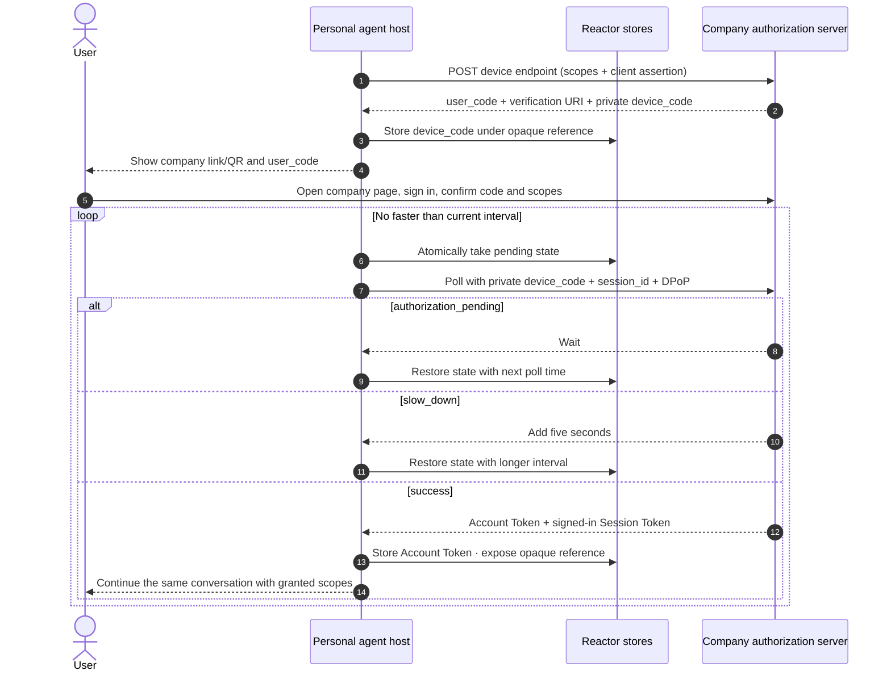

# Device Sign-In

Device Sign-In is the fallback when the personal agent cannot receive a Direct
Sign-In browser callback. The user authenticates on the company's own page;
the personal agent never handles a password, one-time password, or approval
click.

Prefer Direct Sign-In when it is available. Device Sign-In adds polling and a
code-entry step, but it works for terminals, remote runtimes, and devices that
cannot host a callback.



## Python

```python
client = DeviceSignInClient(reactor=reactor, http_client=http)
started = await client.begin(
    device_authorization_endpoint=metadata.device_authorization_endpoint,
    token_endpoint=metadata.token_endpoint,
    issuer=metadata.issuer,
    client_id="https://agent.example/agent.json",
    scopes=("orders:read", "orders:return"),
    tenant_id="application-42",
    pairwise_user_id=pairwise_user_id,
    session_id=signed_out_session.session_id,
    organization=company.document.organization,
    poppy_domains=metadata.poppy_domains,
)

# Render only these human-facing values. A UI may turn the complete URI into a QR.
show_to_user(started.verification_uri_complete or started.verification_uri)
show_to_user(started.user_code)

result = await client.poll(started.reference)
if result.status == "pending":
    schedule_at(result.retry_at)
```

## TypeScript

```typescript
const client = new DeviceSignInClient({ reactor, fetch });
const started = await client.begin({
  deviceAuthorizationEndpoint: metadata.device_authorization_endpoint,
  tokenEndpoint: metadata.token_endpoint,
  issuer: metadata.issuer,
  clientId: 'https://agent.example/agent.json',
  scopes: ['orders:read', 'orders:return'],
  tenantId: 'application-42',
  pairwiseUserId,
  sessionId: signedOutSession.sessionId,
  organization: company.document.organization,
  poppyDomains: metadata.poppy_domains,
});

renderHumanHandoff(started.verificationUriComplete ?? started.verificationUri,
                   started.userCode);
const result = await client.poll(started.reference, abortSignal);
```

`begin()` returns an opaque reference, not the `device_code`. `poll()` performs
at most one network poll. It suppresses premature calls locally, adds five
seconds after `slow_down`, and consumes state after success, denial, or expiry.
This makes scheduling explicit for workers and prevents an LLM loop from
accidentally hammering the company endpoint.

On success, both SDKs require a signed-in proof-bound token for the initiating
Session. Extra scopes are rejected and missing scopes are reported. The Account
Token is written directly to the Reactor `TokenStore`; only its opaque reference
crosses into application code. Hosts must provide durable, encrypted,
tenant-isolated state and token stores in production.

Opening `verification_uri_complete` is a navigation, never approval. The user
must see the company domain and confirm the displayed code on the company's
page. Do not automate sign-in, type credentials, follow approval buttons, or
put device codes and tokens in logs, analytics, model context, QR telemetry, or
browser state.

See the runnable [Device Sign-In example](/examples/device-sign-in/) and the
upstream [Device Sign-In specification](https://personalagentprotocol.org/docs/spec#46-device-sign-in).
