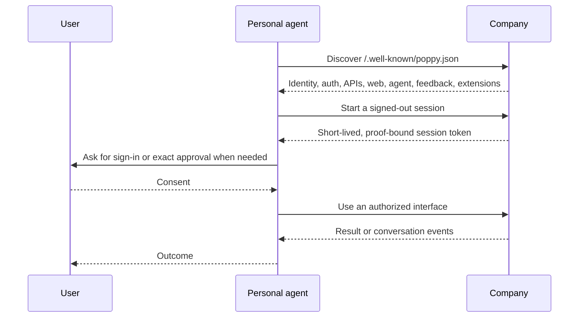

# 🤖 🌸 Personal Agent Protocol

Python and TypeScript SDKs for the
[Personal Agent Protocol](https://personalagentprotocol.org) (PAP, or Poppy),
targeting [draft 0.2](https://personalagentprotocol.org/docs/0.2/spec) and its
[Operations extension](https://personalagentprotocol.org/docs/0.2/extensions/operations)
version 1.

Build software that lets a personal agent work with a company on a user's
behalf, without pretending to be the user or hiding automation. PAP gives
both sides a common path for discovery, scoped authorization, web and API
access, and conversations. The SDKs use
[Datalayer Reactor](https://reactor.datalayer.tech) for replaceable platform
services and optional protocol extensions.

## The specification and where it lives

The protocol is specified by the
[Personal Agent Protocol organization on GitHub](https://github.com/personal-agent-protocol),
in the public
[personal-agent-protocol/personal-agent-protocol](https://github.com/personal-agent-protocol/personal-agent-protocol)
repository. That repository is the source of the protocol's website,
[personalagentprotocol.org](https://personalagentprotocol.org), which
publishes:

- the [introduction](https://personalagentprotocol.org/docs/introduction) and
  the [path to 1.0](https://personalagentprotocol.org/docs/path-to-1);
- each version of the
  [specification](https://personalagentprotocol.org/docs/0.2/spec),
  [extensions](https://personalagentprotocol.org/docs/0.2/extensions) and
  [guides](https://personalagentprotocol.org/docs/0.2/guides): draft 0.2 is in
  progress, and version 0.1 is frozen at
  [/docs/0.1/spec](https://personalagentprotocol.org/docs/0.1/spec);
- the [changelog](https://personalagentprotocol.org/docs/changelog) between
  versions; and
- a Company implementation kit.

Feedback on the protocol goes to the
[issues of that repository](https://github.com/personal-agent-protocol/personal-agent-protocol/issues)
(see [How to give feedback](https://personalagentprotocol.org/docs/path-to-1#feedback)).
Issues with these SDKs go to
[datalayer/personal-agent-protocol](https://github.com/datalayer/personal-agent-protocol/issues).

The specification is authoritative. These docs record which upstream revision
the SDKs implement ([Protocol coverage](/protocol/coverage/)) and how they
implement it.

:::caution Draft protocol

PAP can change incompatibly before its first stable version. Before 1.0, each
`major.minor` version can break the one before, so a personal agent uses only
a company document whose `protocol_version` it supports: these SDKs speak
draft 0.2. See [Compatibility](/releases/compatibility/) and
[Migration](/releases/migration/).

:::

## Pick your role

| I am building…                              | Start here                                              |
| ------------------------------------------- | ------------------------------------------------------- |
| A personal agent that connects to companies | [Personal-agent guide](/guides/personal-agent/)         |
| A company endpoint for personal agents      | [Company guide](/guides/company/)                       |
| A platform integration or PAP capability    | [Extensions guide](/guides/extensions/)                 |
| A terminal or third-party command extension | [`pap` CLI guide](/guides/cli/)                         |
| By following end-to-end feature flows       | [Example flows](/examples/)                             |
| Against one of the SDKs                     | [Python](/sdk/python/) · [TypeScript](/sdk/typescript/) |
| Datalayer Studio integration                | [Studio integration](/studio/integration/)              |

## The interaction at a glance

[Get started](/getting-started/) with working discovery code, take the
[protocol tour](/concepts/protocol-tour/), or review the
[implementation status](/protocol/status/) and the
[protocol coverage](/protocol/coverage/), requirement by requirement.

## Two protocol roles

The SDKs implement both sides of PAP:

1. A **personal agent client** discovers and works with companies for one
   user: Sessions, every sign-in type, Account Tokens, APIs and MCP, the
   website, conversations, feedback, and Operations.
1. A **reference company**, in Python and in TypeScript, publishes discovery,
   issues Sessions, and serves APIs, MCP, a company agent and Operations; every
   replaceable part is a Reactor contribution point.
