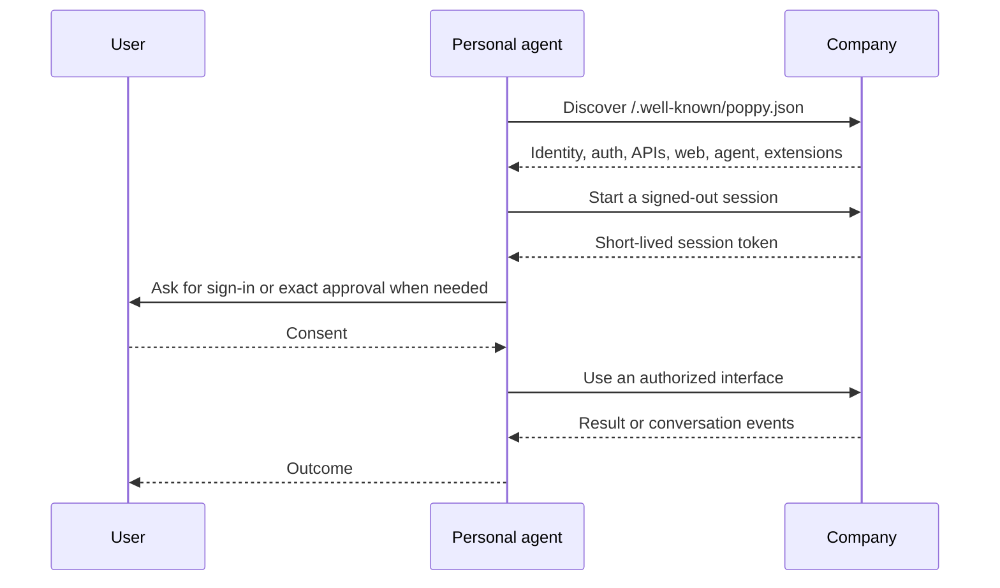

# 🤖 🌸 Personal Agent Protocol

Build software that lets a personal agent work with a company on a user's
behalf—without pretending to be the user or hiding automation.

The Personal Agent Protocol (PAP, or Poppy) gives both sides a common path for
discovery, scoped authorization, web and API access, and conversations. These
Python and TypeScript SDKs target
[PAP draft 0.1](https://personalagentprotocol.org/docs/spec) and use
[Datalayer Reactor](https://reactor.datalayer.tech) for replaceable platform
services and optional protocol extensions.

:::caution Draft and preview software

PAP can change incompatibly before its first stable version. The SDKs are an
early implementation: discovery, foundational session value objects, and
Direct Sign-In primitives and one-use browser/proof-bound exchange
orchestration work in both SDKs. Signed-out session
start and renewal work when the host supplies secure signing and DPoP
providers. Browser Session form-post handoff and company-side assertion
verification are also implemented. Conversation creation and continuation work
in both SDKs. Local JOSE providers are available; managed key custody, Account
Token lifecycle, company services, conversation events, and Operations are not ready.

:::

## Pick your role

| I am building…                              | Start here                                              |
| ------------------------------------------- | ------------------------------------------------------- |
| A personal agent that connects to companies | [Personal-agent guide](/guides/personal-agent/)         |
| A company endpoint for personal agents      | [Company guide](/guides/company/)                       |
| A platform integration or PAP capability    | [Extensions guide](/guides/extensions/)                 |
| A terminal or third-party command extension | [`pap` CLI guide](/guides/cli/)                         |
| By following end-to-end feature flows       | [Example flows](/examples/)                             |
| Against one of the SDKs                     | [Python](/sdk/python/) · [TypeScript](/sdk/typescript/) |
| Datalayer Studio integration                | [Studio integration](/studio/integration/)              |

## What is available

The current `0.3.x` preview line includes:

- strict, forward-compatible discovery and OAuth metadata models;
- safe `/.well-known/poppy.json` discovery with domain and issuer binding;
- Python and TypeScript packages driven by Datalayer Reactor contribution
  points;
- strict duplicate-member rejection at both JSON trust boundaries;
- aligned, fail-closed Reactor contracts for signing, protected keys, tokens,
  DPoP proofs, cache, and browser handoff;
- session-token and assertion primitives plus signed-out session start and
  renewal over HTTP for the PAP 4.2 implementation slice;
- ES256/RS256 assertion signing and DPoP creation and verification with nonce,
  request, token-hash, freshness, and replay checks;
- Direct Sign-In state, S256 PKCE, callback, exchange-grant, and
  browser/exchange orchestration in both SDKs;
- Browser Session assertion, controlled form POST, and replay-safe company
  verification in both SDKs;
- DPoP-aware conversation creation and continuation with user-global
  idempotent message IDs in both SDKs;
- a Reactor-extensible `pap` CLI for non-secret profiles, verified discovery,
  and extension diagnostics; and
- shared fixtures and cross-language validation tests.

Managed key custody, durable replay storage, device and mediated sign-in,
conversation events/streaming, Operations v1, and company/server adapters
remain under active development.
Pages label planned surfaces rather than presenting them as released behavior.

## The interaction at a glance

[Get started](/getting-started/) with working discovery code, take the
[protocol tour](/concepts/protocol-tour/), or review the exact
[implementation status](/protocol/status/) and
[protocol coverage target](/protocol/coverage/).

## Two protocol roles

The SDKs will support both sides of PAP:

1. A **personal agent client** discovers and works with companies for one user.
2. A **company implementation** publishes discovery, issues sessions, and
   exposes APIs or a company agent.

The current executable vertical slice covers personal-agent discovery and
signed-out session start or renewal when the host supplies secure signing and
DPoP providers. Availability labels in these docs are deliberate:
**implemented** means code and tests exist; **planned** describes the intended
API and must not be relied on.
